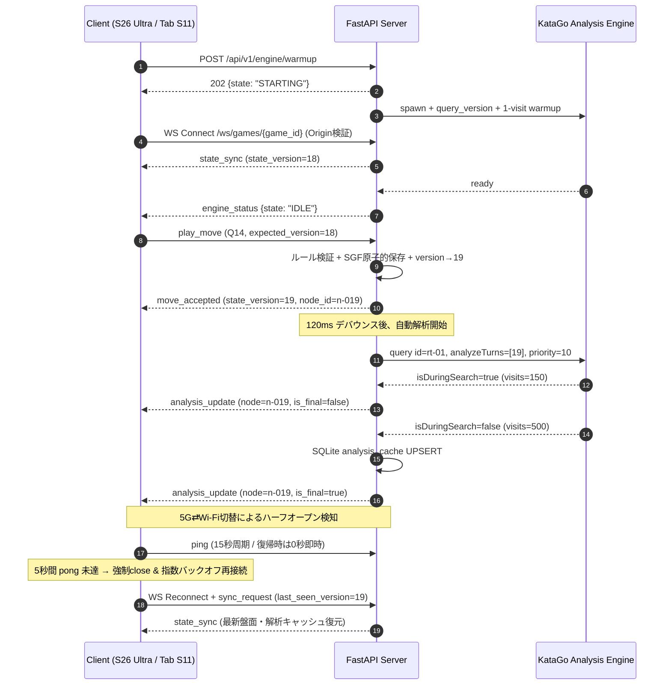
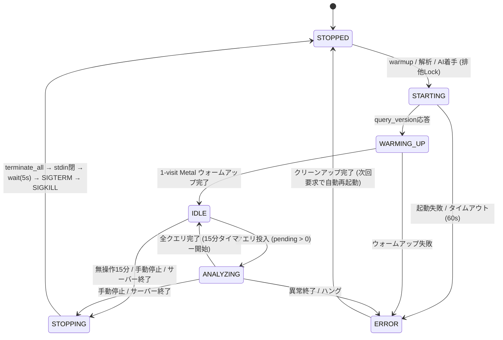
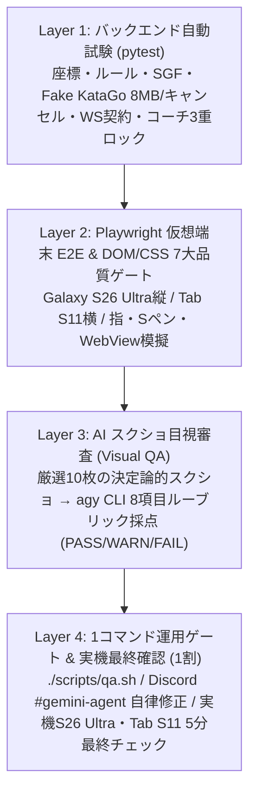

# スマホ・タブレット対応「Web 碁盤（KataGo × Gemini）」統合設計書

> **ステータス:** 統合詳細設計完了（4専門視点レビュー＆矛盾審査済み・実装前）  
> **最終更新:** 2026-11-21  
> **想定クライアント:** Galaxy S26 Ultra（縦画面・Sペン対応）／ Galaxy Tab S11（横画面・Sペン対応）  
> **想定サーバー:** Mac mini（Apple M6 / メモリ 16GB / Tailscale 経由）  
> **配信・移行方針:** 再インストール不要な **PWA 先行** ➔ 将来「外枠だけ Android アプリ化（薄い Kotlin WebView ラッパー）」へ無痛移行  
> **予定配置先:** `projects/web-goban/`（※本ドキュメントは設計専用であり、実装コードは未作成）

---

## 1. コンセプト・前提環境・設計原則・審査統合サマリー

### 1-1. コンセプトと狙い

**「盤面の表示と操作はスマホ・タブレット（指＆Sペン）、頭脳（計算）は Mac mini の KataGo、先生（日本語解説）は Gemini、品質保証は Mac mini 上の仮想自動試験」**

現在稼働中の「Chrome リモートデスクトップ ＋ KaTrain」でも対局・検討は可能ですが、以下の課題があります。

- スマホ（19路盤）では画面が小さく、指タップでほぼ確実に 1 路ズレる
- 画面映像を常時ストリーミングするため通信量・バッテリー消費が大きい
- KataGo は勝率・目数・候補手はプロ超えだが、**「なぜその手が良い／悪いのか」を日本語で解説してくれない**
- ネイティブ Android アプリを最初から組むと、見た目の微調整のたびに APK ビルド・実機転送・インストールが必要になり開発サイクルが鈍化する

これらを **Tailscale（HTTPS/WSS）＋ 再インストール不要の PWA（将来 WebView ラッパー無痛移行対応）＋ Mac mini 常駐 KataGo ＋ Gemini コーチ ＋ Mac mini 完結型 4 層仮想自動試験** の組み合わせで一気に解決します。

### 1-2. 実機確認済みの前提環境（Mac mini / Android）

本設計は `my-lab` リポジトリおよび Mac mini 実機で確認済みの既存資産をそのまま活かす前提で組んでいます。

| 要素 | 実機確認済みの構成 | 本プロジェクトでの活用 |
| :--- | :--- | :--- |
| **サーバー本体** | Mac mini（Apple M6 / メモリ 16GB / macOS、スリープ防止済） | FastAPI 常駐・KataGo オンデマンド実行・仮想自動試験の実行基盤 |
| **囲碁AIエンジン** | `/opt/homebrew/bin/katago`（**KataGo v1.18.2 / Metal GPU**） | Analysis Engine モード（NDJSON）で直接連携。`-human-model` 対応確認済 |
| **導入済み強モデル** | `/opt/homebrew/share/katago/kata1-b18c384nbt-s9996604416-d4316597426.bin.gz`（約98MB） | 既存 KaTrain 環境とモデルを共有（二重配置不要） |
| **Python 実行環境** | `/opt/homebrew/bin/python3.12` | `projects/web-goban/.venv` に FastAPI・uvicorn・pytest・Python 版 Playwright を完結配置 |
| **AI 解説＆審査基盤** | `/Users/sasadayuto/.local/bin/agy`（Antigravity CLI 稼働中） | 無料 Gemini API キー制限（1日20回・503エラー）を回避する初期標準プロバイダ＆AIスクショ審査エンジン |
| **ネットワーク** | Tailscale（Mac App Store 版 `/Applications/Tailscale.app/Contents/MacOS/Tailscale` / 3台疎通済） | 標準 HTTP/WS（本運用は `tailscale serve` による正規 HTTPS/WSS）で外出先からも直結 |
| **クライアント端末①** | **Galaxy S26 Ultra**（6.9インチ 19.5:9 / 縦メイン・**Sペン内蔵**） | 片手誤タップ防止 UI ＋ Sペン Air View ホバー両対応 |
| **クライアント端末②** | **Galaxy Tab S11**（11.0インチ 16:10 / 横メイン・**Sペン同梱**） | フルハイト正方形盤面＋右統合パネルの 2 カラム検討・対局 UI |
| **既存稼働サービス** | `music-automation` / `discord-ai-agent`（`launchd` 常駐） / `KaTrain`（手動起動・`12×8` 大メモリ設定） | ポート・プロセス分離および KaTrain 同時稼働検知による安全共存を設計に内蔵 |

### 1-3. 設計上の 6 大原則

1. **ネットワーク非依存（将来の引っ越し対応）：** すべて標準の HTTP / WebSocket・相対パス（＋任意ベース URL 注入）で設計し、将来 Tailscale から ZeroTier や Cloudflare Tunnel へ乗り換えてもアプリ改修ゼロで動かす。
2. **ビルド不要のシンプル構成：** フロントエンドは複雑な React / Node ビルド環境を持たず、素の **HTML + CSS + Vanilla JS（ES Modules / 2層 Canvas + SVG）** で構築。Discord `#gemini-agent` からの小改修も即反映できる。
3. **PWA 先行 ➔ WebView ラッパー無痛移行：** 最初は再インストール不要な PWA で高速に磨き込み、OS 依存操作はすべて `PlatformBridge` 1 箇所に閉じ込めることで、将来の外枠 Android アプリ化を Web 側改修ゼロで実現する。
4. **単一ソースの原則（Single Source of Truth）：** 囲碁ルール判定（コウ・自殺手・打ち上げ・SGF 分岐木）はサーバー（Python）を唯一の正とし、フロントとバックエンドの二重実装バグを根絶する。
5. **事実ベース解説（4層ハルシネーション抑止）：** Gemini に生の盤面図を読ませず、KataGo と Python が確定させた構造化ファクト JSON だけを渡し、スキーマ強制・条件付き禁止語・出力ポスト検証で嘘を構造的に封じる。
6. **実機往復ゼロの仮想自動試験（Shift-Left QA）：** `pytest` ＋ Playwright 仮想端末（S26 Ultra / Tab S11）＋ AI スクショ目視審査を Mac mini 上で 1〜2 分完結させ、実機確認は節目の「最終 1 割の手触り確認」だけに絞る。

### 1-4. 4 専門視点レビュー＆審査統合で確定した重要判断ログ

UI/UX・技術アーキテクチャ・Gemini コーチ・QA の 4 領域を横断審査し、以下の矛盾・欠陥・落とし穴を実装前にすべて解消しました。

| 論点 | 発見された課題・矛盾 | 統合設計での最終採用方針 |
| :--- | :--- | :--- |
| **Tab S11 横レイアウトの盤面圧迫** | 旧案（左 65%＋上下バー計 100px）では 16:10 画面（`1280×800`）で盤面が `660px` に縮み左右に `170px` の無駄な黒帯が発生＋Sペン手のひら誤爆リスクがあった | **左カラム上下バーを全廃しフルハイト正方形盤面（約 `752×752px`）へ最大化、右カラムは残り全幅（約 `480〜520px`）へ開放**（左利き反転可） |
| **S26 Ultra の Sペン対応＆レイアウトシフト矛盾** | S26 Ultra の Sペン内蔵が見落とされていた。また分岐バッジ・通信バナーをフロー差し込みしており「レイアウトシフト 0px」と矛盾していた | S26 Ultra 縦でも Sペン Air View ホバー PV・照準表示に対応。分岐バッジ・通信バナーは**盤面内オーバーレイ化**しシフト `0.0px` を厳守。19.5:9 の縦余白（約 220px）は自動縮退する**可変ミニ情報帯**で活用 |
| **PWA ↔ WebView ↔ QA の境界統一** | 各担当案で JS Bridge 名・Safe Area CSS 変数名・オフセット量・パームガード時間が微妙にズレていた | ① Native 口は `window.WebGobanNative` / Web 受信口は `window.WebGobanApp` / 統一層は `PlatformBridge` に統一<br>② Safe Area は共通変数 `--app-inset-*` に統一（WebView 注入と Playwright 仮想試験で同一経路を共有）<br>③ 上オフセット `52px`・パームガード `350ms`・ボトムシート `52/84dvh`・上部バー `44px` で全章統一 |
| **大差判定の矛盾＆置き石局破綻** | 旧案は `GoFactBridge`（95%/15目）と悪手バッジ（>97%）が不一致。さらに置き石局で 1 手目から 97% 超になり大差抑制が暴発する欠陥があった | **単一の `is_garbage_time` 判定**を UI・グラフ・Gemini・ドリルで共有（互先/置き石を分岐＋勝率 `15〜85%` への大逆転ポカ時は抑制解除＋盤サイズ別閾値スケーリング） |
| **KataGo 設定＆キャンセル汚染** | 既存 KaTrain が `12×8=96` スレッド（`nnMaxBatchSize=96`）で動く実態が判明。また `terminate` 時の途中 visits 応答が SQLite キャッシュを汚染する罠があった | GPU-only 明示（`metalDeviceToUseThread0=0`）・`2×8` スレッド・`nnMaxBatchSize=16`・`assumeMultipleStartingBlackMovesAreHandicap=false`・`stdout` 上限 **8MB**・`terminated_ids` キャッシュ禁止・`KaTrain` 稼働検知時の自動 warmup 抑止を採用 |
| **`agy` CLI の隔離盲点＆生 JSON 露出** | リポジトリ内 `.coach-sandbox/` は親の `AGENTS.md` を遡り参照する恐れがあり、`stream-json` 直流しは未検証の嘘や JSON 記号が画面露出するリスクがあった | リポジトリ外隔離 `cwd`（`~/Library/Caches/web-goban-coach-sandbox/`）＋ `--output-format json --json-schema` ＋ PGID 単位の孫プロセス確実終了（`killpg`）＋ Python 0.05秒速報先出しへ統一 |
| **ルール単一ソース vs オフライン閲覧** | JS 側に囲碁ルールを二重実装するとバグ温床になる | Phase 1 はサーバー単独。Phase 3 のオフライン閲覧は「各ノードに打ち上げ石リストを保存した再生専用スナップショット」を IndexedDB キャッシュし**二重実装ゼロ**で実現 |

---

## 2. システム全体像（アーキテクチャ・構成・データ設計）

### 2-1. 全体構成図

```text
[Galaxy S26 Ultra (縦・指＋Sペン)] / [Galaxy Tab S11 (横・Sペン＋指)]
  │ Phase 1〜2: Samsung ブラウザ（HTTPS PWA：アドレスバーなし全画面・再インストール不要）
  │ Phase 3+ : 薄い Kotlin WebView ラッパー APK（任意移行・Web側改修ゼロ・PlatformBridge自動連携）
  │ 送受信は「着手座標・解析数値・解説JSON」の軽量データのみ
  ▼  Tailscale 暗号化トンネル（本運用: tailscale serve による正規 HTTPS / WSS）
[Mac mini (Apple M6 / 16GB / 常時稼働)]
  ├─ Webサーバー：FastAPI + uvicorn（Python 3.12 / 127.0.0.1:8090 / --workers 1 / launchd常駐）
  │    ├─ 静的フロント配信（HTML / CSS / Vanilla JS ES Modules / ?v=<build_id> キャッシュ制御）
  │    ├─ REST API（/api/v1：棋譜・セッション・エンジン制御・Geminiコーチ・画像/SGF取込）
  │    ├─ WebSocket API（/ws/games/{game_id}：盤面同期・途中経過配信・15s/5s Heartbeat）
  │    ├─ Go ルールエンジン＆SGF木管理（唯一の正 / Single Source of Truth）
  │    ├─ チャンク式一括検討スケジューラ（対話優先割り込み制御）
  │    └─ GoFactBridge（KataGo数値＋盤面グラフ → 構造化ファクトJSON＋4層ハルシネーション検証）
  │
  ├─ 思考エンジン：KataGo v1.18.2（Homebrew Metal GPU-only・オンデマンド起動＆15分自動停止）
  │    └─ Analysis Engine モード（stdin/stdout NDJSON 通信・最大8MBバッファ）
  │
  ├─ 解説エンジン：CoachProvider（プラガブル抽象層＋サーキットブレーカー）
  │    ├─ [初期標準] AgyCliProvider（agy CLI / リポジトリ外隔離実行 / --json-schema）
  │    ├─ [高速切替] GeminiApiProvider（従量課金 Flash 系・.env 1行切替）
  │    └─ [非常用]   RuleBasedFallbackProvider（0.01秒・嘘ゼロの定型日本語解説）
  │
  ├─ 永続化ストレージ（projects/web-goban/data/）
  │    ├─ 標準 .sgf 原本ファイル（KaTrain 等でも開ける・原子的置換保存）
  │    ├─ SQLite 単一 DB（goban.db / WALモード：セッション・棋譜索引・解析/解説キャッシュ・ドリル）
  │    └─ Markdown 振り返りレポート（YAML Frontmatter 付・任意で Discord Webhook 投稿）
  │
  └─ 仮想自動試験基盤（projects/web-goban/tests/：本番データ・ポートと完全隔離）
       └─ ./scripts/qa.sh ➔ Layer1(pytest) ➔ Layer2(Playwright仮想端末) ➔ Layer3(agy AIスクショ審査)
```

### 2-2. 予定ディレクトリ構成（`projects/web-goban/`）

```text
projects/web-goban/
├── config/
│   └── katago_analysis.cfg         # Git管理：Apple M6 / 16GB / KaTrain共存向け KataGo設定
├── app/                            # Git管理：FastAPI バックエンド一式
│   ├── main.py                     # アプリ入口・lifespan（子プロセス確実終了）・静的ハッシュ配信
│   ├── config.py                   # .env 読込・ALLOWED_ORIGINS・テスト用DI境界
│   ├── coords.py                   # 座標変換の一元管理（内部/GTP/SGF/ownership・9/13/19路）
│   ├── rules.py                    # 盤面ルール判定・SGF木構造・戦術プリミティブ抽出
│   ├── katago_engine.py            # AnalysisEngineProtocol / KataGoプロセス管理・チャンクスケジューラ
│   ├── game_hub.py                 # 複数端末WS管理・楽観ロック・ローカル視点分離・Heartbeat
│   ├── fact_bridge.py              # KataGo数値 → 構造化ファクトJSON・統一悪手判定（Phase 2）
│   ├── coach_provider.py           # AgyCli / GeminiApi / Fallback 抽象層・4層検証（Phase 2）
│   ├── schemas/                    # JSON Schema（explain / hint / review）
│   └── db.py                       # SQLite（WALモード・直列書込）操作
├── static/                         # Git管理：ビルド不要のフロントエンド（ES Modules 6構成）
│   ├── index.html
│   ├── manifest.webmanifest        # PWA 設定（standalone / dark #1A1D21 / maskable）
│   ├── sw.js                       # Service Worker（WebView環境時は登録自動スキップ）
│   ├── css/                        # 3モードレスポンシブ・--app-inset-* 安全領域・ダーク基調
│   └── js/
│       ├── platform-bridge.js      # PWA ↔ Android WebView 無痛移行抽象層
│       ├── goban-canvas.js         # 2層Canvas盤面・非整数DPRスナップ・ヒートマップ・PV描画
│       ├── input-controller.js     # PointerEvent状態機械（指オフセット・Sペンホバー・ピンチ分離）
│       ├── ws-client.js            # WS接続・15s/5s Heartbeat・指数バックオフ再接続
│       ├── ui-shell.js             # 3モードUI・ボトムシート・SVGグラフ・ディープリンク
│       └── coach-view.js           # 解説カード・3重ロック段階ヒント・TTS読み上げ（Phase 2）
├── scripts/
│   └── qa.sh                       # Git管理：1コマンド統合QAランナー（fast|e2e|visual|live|all）
├── tests/                          # Git管理：4層仮想自動試験スイート（第7章参照）
│   ├── conftest.py
│   ├── fakes/                      # fake_katago.py / fake_coach.py
│   ├── fixtures/                   # 決定論的SGF・固定解析JSON・壊れたSGF群
│   ├── unit/                       # Layer 1: pytest 単体・統合・実機スモーク
│   ├── e2e/                        # Layer 2: Playwright 仮想端末・7大レイアウト品質ゲート
│   ├── visual_qa/                  # Layer 3: AIスクショ目視審査ルーブリック＆ランナー
│   └── artifacts/                  # .gitignore対象：撮影スクショ・審査JSON/MD・トレース
├── com.mylab.web-goban.plist       # Git管理：launchd 常駐設定テンプレート
├── requirements.txt                # Git管理：本番依存（FastAPI / uvicorn / aiosqlite / pydantic等）
├── requirements-dev.txt            # Git管理：QA依存（pytest / pytest-asyncio / httpx / playwright）
├── pyproject.toml                  # Git管理：pytest マーカー定義
├── .env                            # .gitignore対象：許可Origin・プロバイダ・APIキー・Webhook等
└── data/                           # .gitignore対象：本番ユーザーデータ一式
    ├── sgf/YYYY/MM/<uuid>.sgf      # 棋譜原本（標準 SGF 形式・原子的置換保存）
    ├── reports/                    # 1局振り返りレポート（YAML Frontmatter 付 Markdown）
    ├── db/goban.db                 # SQLite 単一 DB（WAL モード）
    └── logs/                       # app.log（ローテーション済）/ katago/（最新5世代保持）
```

### 2-3. データ永続化ハイブリッド設計（`.sgf` 原本 ＋ 単一 SQLite）

- **棋譜の正本は標準 `.sgf` ファイル：** Finder や `KaTrain` でもそのまま開ける標準資産として保存。着手・更新時は `一時ファイル書き出し → fsync → os.replace` の**原子的置換**を行い、強制終了でも棋譜破損をゼロにする。重い KataGo 数値配列は `.sgf` に埋め込まず、人間向けの総評や悪手コメント（`C[...]`）のみ任意で追記する。
- **セッション・高速検索・キャッシュ・上達データは `goban.db`（SQLite WAL モード）に一元化：**
  - `games`: アクティブ対局／検討セッション（`game_id`, `sgf_id`, `latest_node_id`, `state_version`, `mode`, `ai_level`, `updated_at`）。サーバー再起動後や、**通勤時 S26 Ultra ➔ 帰宅後 Tab S11** の端末跨ぎでも 1 タップで前回の続きを復元。
  - `sgf_records`: 棋譜索引（UUID、タイトル、対局日、盤サイズ、手数、自分色、結果、タグ、`.sgf` 相対パス、フェーズ別平均損目・ミスカテゴリ集計）。
  - `analysis_cache`: 7 要素ハッシュ `position_hash = hash(board_size, stones, next_player, ko_point, rules, komi, model_fingerprint)` に対する確定評価値（`actual_visits`, `rootInfo`, 上位 `moveInfos`, `ownership`）。既存より高 `actual_visits` の正常完了結果のみ UPSERT。
  - `coach_cache`: `(position_hash, target_move, coach_mode, skill_level, prompt_version)` をキーにした Gemini 解説キャッシュ（`prompt_version` はプロンプト＋スキーマから自動 SHA-256 算出。フォールバック応答はキャッシュしない）。
  - `drill_questions`: 悪手リベンジ・ドリル用の出題局面・Leitner ボックス・次回出題日・除外フラグ（Phase 3）。

### 2-4. 盤面ルール・SGF 木構造の責務分担と複数端末同期

| 責務 | FastAPI サーバー（唯一の正） | フロントエンド（Vanilla JS） |
| :--- | :--- | :--- |
| **ルール判定** | 自殺手・単コウ（必要時スーパーコウ）・多子打ち上げ・アゲハマ・置き石・連続パス（対局時終局 / 検討時続行可）を厳密判定 | 空点チェックなど明白な UI ガードのみ（二重実装しない） |
| **着手レスポンス** | Tailscale 内で約 5〜20ms で `move_accepted` を返却し全接続端末へ配信 | 確定タップ時に即時仮描画し、`move_accepted` で確定、`move_rejected` なら消去＋理由トースト表示 |
| **複数端末同時閲覧** | **共有ミューテーション**（着手/待った/SGF読込）は `expected_version` 楽観ロックで直列化。**端末ローカル視点**（`navigate` 手数移動・ズーム・地合い ON/OFF）は `client_id` ごとに独立管理 | 他端末が別手数を検討しても自分の盤面が勝手に飛ばない。最新手追従中（`following_latest`）のみ新規着手に自動追従 |
| **オフライン閲覧（Phase 3）** | 各ノードに「着手座標＋その手で打ち上げた石座標」を付与して配信 | IndexedDB 保存済みの直近棋譜を「閲覧・再生専用」として手数移動のみオフライン動作 |

---

## 3. UI/UX・端末別画面・Sペン・誤タップ防止・PWA ➔ Android アプリ化無痛移行設計

### 3-1. 想定 2 端末のハードウェア基準値＆ 3 モードレスポンシブ

| 項目 | Galaxy S26 Ultra（縦メイン＋Sペン内蔵） | Galaxy Tab S11（横メイン＋Sペン同梱） |
| :--- | :--- | :--- |
| **画面サイズ / 比率** | 6.9 インチ（19.5:9 / 120Hz） | 11.0 インチ（16:10 / 120Hz） |
| **物理解像度 / 想定 DPR** | QHD+ `1440×3120`（DPR `3.5〜3.75`）／ FHD+ 時 `1080×2340` | `2560×1600`（DPR `2.0` 基準） |
| **想定 CSS ビューポート** | **縦：`384〜412 × 832〜892 px`**<br>（※通常ブラウザバー展開時は高さ約 `700〜740 px`） | **横：`1280 × 800 px`**（タスクバー時 `1280 × 744 px`）<br>縦：`800 × 1280 px` |
| **Sペン特性** | パッシブ EMR（非 Bluetooth・Air View ホバー対応・サイドボタン有） | パッシブ EMR（非 Bluetooth・Air View ホバー対応・サイドボタン有） |
| **19路盤 描画サイズ目安** | 幅 100%（`384〜412 px` 四方・左右 16px 安全座標帯込み） | **左フルハイト正方形：`約 752 × 752 px`**（上下バー撤廃で最大化） |
| **1交点あたり幅（19路）** | **約 `18.5〜20.0 CSS px`**（指幅の半分以下 ➔ 指は仮置き必須／Sペンは直接狙える） | **約 `37.0〜38.5 CSS px`**（Sペンで余裕の直接着手） |

#### レスポンシブ 3 モード切替ルール
1. **モバイル縦（1 カラム・デフォルト）：** 幅 `< 768px` 等（S26 Ultra 縦）。盤面幅 100% ＋ 可変ミニ情報帯 ＋ 52px 固定アクションバー ＋ 下部ツールバー ＋ ボトムシート。
2. **タブレット縦（1 カラム常設パネル）：** `(min-width: 768px) and (orientation: portrait)`（Tab S11 縦）。盤面を `min(100vw, 58dvh)` に収め、下部 42% にグラフ＆候補手/Gemini パネルをシート格納せず常時表示。
3. **タブレット横 / PC（フルハイト 2 カラム）：** `(min-width: 900px) and (orientation: landscape)` または `(min-width: 1024px)`（Tab S11 横）。左＝フルハイト正方形盤面、右＝残り全幅（約 `480〜520px`）の統合パネル（左利き設定で `row-reverse` 反転可）。

#### 共通レイアウト品質基準
- **最小タップ領域：** **推奨 `48×48 CSS px`（最小 `44×44 CSS px` 厳守）**、隣接ボタン間隔 **`8px` 以上**（確定・取消間は `12px` 以上）。
- **動的ビューポート＆安全領域：** ルートは `position: fixed; inset: 0;`（補助 `--app-height`）、安全領域は全方向 **`max(env(safe-area-inset-*, 0px), var(--app-inset-*, 0px))`** で統一（PWA の `env()`・将来 WebView の `WindowInsets` 注入・Playwright 仮想端末テストの 3 経路を同一 CSS で完全統一）。
- **盤面レイアウトシフト `0.0px` 厳守：** 通信断バナー・分岐バッジ・ズームリセットボタンは盤面内オーバーレイ配置とし、アクションバー高さ（スマホ `52px` / タブ `48px`）を状態によらず完全固定する。

---

### 3-2. 端末別ワイヤーフレーム

#### ① Galaxy S26 Ultra（縦画面・片手指操作＋Sペン両対応）

19.5:9 の超縦長画面で生じる約 220px の余白を、盤面を押し動かさない可変枠 **`[2b] 可変ミニ情報帯（flex: 1）`** として有効活用します（ブラウザバー展開時など高さ `<= 700px` では自動非表示へ縮退）。

```text
+------------------------------------------+  <- max(env(safe-area-inset-top), var(--app-inset-top))
| 🟢 124手目(黒番)  [■■■■■■■□□□] 黒+2.4目 ⚙ |  <- [1] 上部ステータスバー (44px固定)
+------------------------------------------+
| [通信断時のみ: 盤面上端24pxオーバーレイ]   |  <- フロー非干渉(レイアウトシフト 0px)
|  [🌿分岐 +3手 | 本譜へ]        [🔍100%]   |  <- 条件付き盤面内半透明ピル
|    A B C D E F G H J K L M N O P Q R S T |
| 19 . . . . . . . . . . . . . . . . . . . |
|  :                                       |
|  :         [ 19路盤 2層Canvas ]          |  <- [2] 19路盤エリア (幅100%・1:1)
|  :        (左右16px安全余白兼座標帯)      |     ・指: 仮置き＋上52pxオフセットドラッグ
|  :        [Sペンホバー: 照準リング＋      |     ・Sペン: Air View ホバーで照準＆
|  :         候補手上でPV最大5〜6手表示]    |       候補手PVを即表示、タップで直接着手
|  1 . . . . . . . . . . . . . . . . . . . |
+------------------------------------------+
| [可変ミニ情報帯 flex:1 (高<=700pxで非表示)]|  <- [2b] 超縦長余白の有効活用
| 勝率ミニ推移: ──/\──🔴─╲──  (タップで詳細) |     候補チップ押下でPV一時固定表示
| 候補: [🔵Q14 +2.4] [🟢R10 +1.9] [🟡D4 +1.1]|     悪手時/解説済時は1行速報を表示
+------------------------------------------+
| [通常/指] 最善 Q14 (+2.4目/54%) | 仮置き  |  <- [3] 状態連動アクションバー (52px完全固定)
| [仮置き]  黒 Q14  [✕取消]   [✓ 着手確定] |     ※利き手設定で [✓] 左右反転可
| [Sペン👁] 👁 Q14: 54.2% (+2.4目・840v)   |     ※Sペンホバー時はペン軸で隠れないここへ
|           (空点ホバー時: ✒ 照準 K10)      |       座標・評価値をリアルタイム表示
+------------------------------------------+
|  ◀戻る   ▶進む   ✨検討ON  📊詳細   ☰Menu |  <- [4] 下部ツールバー (56px + inset-bottom)
+------------------------------------------+
                   ▲
      [📊詳細]タップ / 上部44pxハンドルドラッグ
+------------------------------------------+
| ═════════ [全画面 ⤢]       [✕ 閉じる] ═══ |  <- [5] 展開式ボトムシート (overlay)
| [ 候補手 ] [ 勝率グラフ ] [ 🤖Gemini ] [分岐]|     2段スナップ: ハーフ(52dvh) / フル(84dvh)
| ---------------------------------------- |     ※ハンドル部のみドラッグ可(スクロール競合防止)
| 1. 🔵 Q14  54.2%  +2.4目  (840v) [PV▶]  |     ※[PV▶]タップでシート自動縮小＋盤面PV固定
| 2. 🟢 R10  51.8%  +1.9目  (420v) [PV▶]  |
+------------------------------------------+
```

- **AI 対局モード時の連動：** `✨検討ON` を `💡ヒント`（Phase 2 の 3 重ロック段階ヒント）へ切替え、`[3]` 通常時に `パス`・`待った`・`投了` を配置。

#### ② Galaxy Tab S11（横画面・フルハイト正方形盤面＋Sペン最適化 2 カラム）

左カラムから上下バーを完全撤廃することで、**①盤面サイズ最大化（約 `752px`・1 交点約 `37.5px`）、②右パネルの横幅拡張（約 `480〜520px`）、③Sペン筆記時の手首による盤面下バー誤爆の構造排除** を同時達成します。

```text
+----------------------------------------------+------------------------------------+ <- inset-top
|                                              | 🟢 124手目(黒) [■■■■■■■□□] +2.4  ☰ | <- [R1] ヘッダー (44px)
|                                              +------------------------------------+
|                                              | 100%       [勝率|目数] [🗺地合い]  |
|                                              |  50% ──/\──🔴──╲───────           | <- [R2] 勝率/目数 SVG
|                                              |   0%        ▲                     |    グラフ (約156px)
|              [ 19路盤 2層Canvas ]             |      1      60       124           |    タップ/ドラッグ移動
|         左カラム：フルハイト正方形最大化        +------------------------------------+
|           (約 752 × 752 CSS px)              | [候補手]  [🤖Gemini]  [対局・分岐] | <- [R3] タブバー (44px)
|           (1交点 約 37.5 CSS px)             | ---------------------------------- |
|                                              | 1.🔵 Q14 54.2% +2.4 (840v) Q14→R10 | <- [R4] スクロール領域
|   ・盤面上下に操作バーなし（手のひら誤爆ゼロ）  | 2.🟢 R10 51.8% +1.9 (420v) R10→Q14 |    (残り高さ flex:1 /
|   ・Sペンホバー: 即時PV(最大8〜10手)プレビュー | 3.🟡 D4  49.5% +1.1 (180v) D4→F3   |     横幅480px+で快適)
|   ・Sペンタップ: 1タップ直接着手               | ---------------------------------- |
|   ・指タップ: 仮置き→右パネル[R5]で確定        | [Gemini解説カード / 振り返り等]     |
|                                              +------------------------------------+
|   ※通信断/ズーム時のみ盤面隅オーバーレイ      | [通常] 🌿分岐 +3手 [本譜へ] / 👁Q14| <- [R5] 状態連動バー
|     [🔍100%]                                 | [仮置] 黒 Q14  [✕取消] [✓着手確定] |    (48px完全固定)
|                                              +------------------------------------+
|                                              | |◀  ◀◀   ◀   ▶   ▶▶  ▶|   ✨検討  | <- [R6] 操作フッター
+----------------------------------------------+------------------------------------+    (56px + inset-bot)
  ◀───────── 盤面正方形 (~752px) ─────────▶   ◀───── 右パネル (残り全幅 ~520px) ────▶
```

---

### 3-3. Sペンホバー＆マルチ入力状態機械（標準 `PointerEvent`）

S26 Ultra・Tab S11 ともに標準 `PointerEvent.pointerType`（`'pen'` / `'touch'` / `'mouse'`）のみで入力デバイスを自動判別し、以下の状態機械で曖昧さを排除します。

```text
IDLE
 ├─ pen: pointermove (buttons===0, pressure===0) ──▶ PEN_HOVERING
 │     ├─ 候補手交点へ滞在 80ms（別候補手切替 50ms）──▶ PVプレビュー表示（他候補手 alpha:0.15 退避）
 │     ├─ 空点ホバー ──▶ 照準リング＋淡い十字ガイド＋固定バーへ ✒ 座標表示
 │     ├─ pointerdown ──▶ PEN_DOWN
 │     │     ├─ 移動<=8px & pointerup ──▶ [自動モード] 1タップ直接着手 / [仮置き設定] TOUCH_GHOST_LOCKED
 │     │     └─ zoom>1.0x & 移動>8px  ──▶ PANNING
 │     └─ pointerleave / 盤外移動 / blur ──▶ IDLE (PV 0ms即消去 + penGuardUntil = now + 350ms)
 │
 ├─ touch (now < penGuardUntil || isPenHovering || width>35 || height>35) ──▶ 無視 (多層パームリジェクション)
 │
 ├─ touch (1本指 pointerdown) ──▶ TOUCH_DOWN
 │     ├─ zoom===1.0x:
 │     │     ├─ 移動<=8px & pointerup ──▶ TOUCH_GHOST_LOCKED (初回オフセット0pxで仮置き)
 │     │     └─ 移動>8px              ──▶ TOUCH_GHOST_DRAGGING (上52pxオフセットへ100msイージング)
 │     │           └─ pointerup ──▶ TOUCH_GHOST_LOCKED ([✓ 着手確定] 待機)
 │     └─ zoom>1.0x:
 │           ├─ 移動<=8px & pointerup ──▶ TOUCH_GHOST_LOCKED (拡大中タップ仮置き)
 │           └─ 移動>8px              ──▶ PANNING (盤面パン移動)
 │
 └─ touch (2本指検知) ──▶ PINCH_ZOOMING (仮置き石を保持したままズーム)
       └─ 全指離脱 (activeTouches===0) ──▶ IDLE (pinchGuardUntil = now + 200ms 誤タップ抑止)
```

#### Sペン設計の重要仕様
- **入力モード設定：** ①**自動（デフォルト）**：`pen`/`mouse`＝直接着手、`touch`＝仮置き＋確定（※「スマホ幅 `< 600px` では Sペンも仮置き」サブトグル併設）、②**常に仮置き＋確定**（揺れる電車内向け）、③**常に直接着手**（9路/早碁向け）。
- **Air View ホバー PV の品質仕様：**
  - ヒステリシス判定：開始半径 `0.45 × cellSize`／離脱半径 `0.55 × cellSize`（境界微振動のチラつき防止）。
  - PV 表示手数上限：スマホ縦 **5〜6 手**／タブ横 **8〜10 手**（棋力レベル連動）。PV 石は半透明 `0.85`＋シアン縁取り＋太字番号で確定石と明確区別。
  - 盤外離脱の確実消去：`pointerleave` の取りこぼし（Android WebView 既知癖）に備え、`document` 側 `pointermove` での盤面外検知・`window.blur`・`visibilitychange` でも 0ms 即消去。
- **4 層パームリジェクション：** ① Galaxy EMR ハード遮断、② Sペンホバー中および離脱後 **`350ms`** 以内の盤面 `touch` 無視、③ 接触幅/高さ `> 35px` の大面積 `touch` 破棄、④ Tab S11 横の盤面下バー撤廃。
- **Sペン サイドボタンの現実的方針：** パッシブ EMR ペンのサイドボタンは One UI の Air Command や WebView テキスト選択と競合し挙動が不安定なため、**必須操作は一切依存させない**。Web では実験的オプション（デフォルト OFF）で「ホバー中補助ボタンによる PV ピン留め」程度に留め、本格活用は将来 WebView ラッパーの `MotionEvent.BUTTON_STYLUS_PRIMARY` 拡張枠とする。

---

### 3-4. 19路盤の誤タップ防止 UX（指操作の決定版）

1. **初回タップとオフセットドラッグの分離（ワープ防止）：**
   - 1 タップ目（移動 `<= 8px`）は **オフセット `0px`** で指直下の最寄り空点へ仮置き。
   - 移動 `> 8px` でドラッグ照準へ移行した瞬間に、上方向オフセット（標準 **`52 CSS px`**、設定で `40 / 52 / 64 / OFF`）へ `100ms` で滑らか移行し、自分の指で狙う交点が隠れないようにする。
2. **盤面上端 5 路の Smoothstep 連続減衰カーブ：**
   - 盤内上端からの距離 `y` が減衰ゾーン `D = offsetMax × 2.2`（約 `114px`）未満のとき、`t = clamp(y / D, 0, 1)` に対し **`effectiveOffset = offsetMax × (3t² - 2t³)`** で滑らかに `0` へ減衰。さらに `setPointerCapture` により上端座標帯へ指がはみ出ても追跡継続し、19 線や隅（A19/T19）も 1 路単位で狙える。
3. **既存石通過時の保持＆交点スナップ振動：**
   - ドラッグ中に既存石を通過しても仮置き解除せず、薄い禁止リング（✕）を表示しつつ直前の有効空点を保持（禁止点上で離したら直前空点へスナップバック）。
   - 交点が 1 マス切り替わるたびに `PlatformBridge.haptic('tick')` で極微細なクリック感を返す（ON/OFF 可）。
4. **誤確定防止＆ピンチ分離：**
   - 確定は固定バーの `[✓ 着手確定]` のみ（仮置き石再タップ確定はデフォルト OFF、ON 時も配置後 `350ms` のダブルタップ誤爆ガード付き）。
   - 2 本指ピンチ（最大 `2.5x`）中は仮置き石を保持し、**全指離脱後 `200ms`** は誤タップ無効化。盤面上ダブルタップズームは完全無効。
5. **Samsung ブラウザ／Android WebView ジェスチャー干渉対策：**
   - `overscroll-behavior: none; overflow: hidden;`（Pull-to-Refresh 防止）、盤面 `touch-action: none;`、`user-select: none; -webkit-touch-callout: none;`（Gemini 解説カード内のみテキスト選択許可）。
   - 盤面左右に **`16px` の座標帯兼安全余白** を設けて Android 画面端「戻る」スワイプの誤爆を軽減（将来 WebView 化時は `View.setSystemGestureExclusionRects` で盤面左右端を物理除外）。

---

### 3-5. 視覚デザイン・描画最適化

- **2 層 Canvas ＋ インライン SVG 構成：**
  - **下層（静的 Canvas）：** 木目背景・罫線・星・座標・確定石（着手・ズーム時のみ再描画で省電力）。
  - **上層（動的 Canvas）：** 地合いヒートマップ・候補手マーカー・PV 仮石・ゴースト石・十字ガイド・Lv3 ぼんやりヒント枠（60fps 追従）。
  - **非整数 DPR の滲み防止：** `dpr = Math.min(window.devicePixelRatio || 1, 3)` としつつ、S26 Ultra 等の非整数 DPR（`2.625` / `3.5`）での罫線モアレを防ぐため **物理ピクセル境界スナップ `(Math.round(pos * dpr) + 0.5) / dpr`** を必須化。
  - **勝率／目数グラフ：** インライン `<svg>` で描画し、悪手バッジのタップ／ドラッグで即座に該当手数へジャンプ。
- **色覚多様性（CUD）配慮の候補手マーカー（色＋枠形状の二重表現）：**
  - **最善手（1 位 / 差 0.3 目以内）：** 青 `#1565C0`（白太文字）＋ **二重リング枠**
  - **有力手（差 0.3〜1.0 目）：** 深緑 `#00897B`（白文字）＋ **太実線リング**
  - **次点（差 1.0〜2.5 目）：** アンバー `#F59E0B`（濃黒文字）＋ **やや小さめの円**
  - スマホ盤面上は文字潰れ防止のため **最大 5 手・1 行のみ表示**（デフォルト：最善からの損目数、設定で勝率%／順位に切替）。
- **地合いヒートマップ＆死活マーク（Phase 1.5）：** `|ownership| >= 0.25` の交点のみ石の下層へ半透明スクエア（最大 `alpha: 0.55`）で表示し、石色と符号逆転の死にかけ石へ薄い `×` マークを表示（デフォルト OFF、ワンタップ切替）。
- **軽量分岐ナビ＆URL ディープリンク：** 本譜離脱中のみ盤面内オーバーレイに `🌿分岐 +3手 [本譜へ]` を表示。URL パラメータは `?game=<game_id>&move=<n>`（セッション再開）、`?sgf=<sgf_id>&move=<n>`（保存棋譜直開）、`?mode=drill`（通勤ドリル直行）に統一。

---

### 3-6. PWA 先行 ➔ 将来「外枠だけ Android アプリ化（WebView ラッパー）」無痛移行設計

#### ① なぜ最初は再インストール不要な PWA で始め、いつ WebView ラッパーへ移行するか
- **Phase 1〜2（PWA 先行）：** Mac mini 上の `static/` を編集してリロードするだけで 2 端末へ即反映され、APK ビルド・転送の手間がゼロ。`tailscale serve` の正規 Let's Encrypt HTTPS により、Samsung ブラウザでもアドレスバーなしの完全全画面アプリとして使える。
  - **初回 HTTPS 化（Mac mini で 1 回だけ実行）：**
    1. Tailscale 管理画面で MagicDNS ＋ HTTPS Certificates を有効化。
    2. `/Applications/Tailscale.app/Contents/MacOS/Tailscale serve --bg http://127.0.0.1:8090`
    3. `https://mac-mini.<tailnet名>.ts.net/` を Samsung ブラウザで開き「ホーム画面に追加（インストール）」。
    （※初回アクセス時のみ ACME 証明書取得で数十秒かかる場合あり）
- **将来（Phase 3+）WebView ラッパーへ移行する具体的トリガー：**
  1. 他囲碁アプリのスクショや `.sgf` を Android 標準の **「共有（`ACTION_SEND`）」メニューから 1 タップで Web 碁盤へ直送** したくなった時
  2. 盤面左右端のシステム「戻る」ジェスチャーを OS レベルで完全除外（`systemGestureExclusionRects`）＆戻るボタン多段制御を完璧にしたい時
  3. 独立アプリアイコン・確実な `FLAG_KEEP_SCREEN_ON`・OS ハプティクス・Sペンサイドボタンのネイティブ捕捉を使いたくなった時
- **TWA（Trusted Web Activity）を不採用とする理由：** TWA は `@JavascriptInterface` によるネイティブ連携ができず、`assetlinks.json` 管理もドメイン引っ越し時の足枷になる。既存 `projects/company-bus-widget` と同じく **薄い Kotlin WebView ラッパー（250〜400 行）＋ GitHub Actions 自動 APK ビルド** の方が圧倒的に自由度が高く無痛。

#### ② 無痛移行の要：`PlatformBridge` 境界契約（`static/js/platform-bridge.js`）
**鉄則：** アプリ本体のコードから `navigator.vibrate` / `wakeLock` / `clipboard` / `share` / `history.back` を直接呼ばず、すべて `PlatformBridge` 経由に統一します。`window.WebGobanNative` が存在すれば Android ネイティブ実装を呼び、不在なら Web 標準 API へ自動フォールバックします。

| 統一メソッド（`PlatformBridge`） | PWA / ブラウザ時（自動フォールバック） | 将来 Android WebView 時（`window.WebGobanNative`） |
| :--- | :--- | :--- |
| **`haptic(kind)`** (`tick`/`place`/`confirm`/`error`) | `navigator.vibrate(ms)`（非対応時 no-op） | `View.performHapticFeedback(...)` |
| **`setKeepScreenOn(enabled)`** | Screen Wake Lock API ＋復帰時再取得 | `FLAG_KEEP_SCREEN_ON` 切替 |
| **`copyText(text)`** | `navigator.clipboard.writeText()` | Android `ClipboardManager` へ直接書込 |
| **`shareOrDownloadFile(opts)`** | `navigator.share({ files })` → `<a download>` | `FileProvider` ＋ Android 標準共有シート |
| **`setSystemBarTheme(hex, darkIcons)`** | `<meta name="theme-color">` 動的更新 | `WindowInsetsControllerCompat` でバー色同期 |
| **`updateBoardExclusionZone(rect)`** | no-op（左右 16px 余白で軽減） | `View.setSystemGestureExclusionRects` へ反映 |
| **`registerBackHandler(fn)`**（`window.WebGobanApp.handleHardwareBack()`） | `popstate` でシート/モーダルのみ最大 1 段吸収 | `OnBackPressedDispatcher` で ①モーダル→②シート→③ズーム→④仮置き→⑤2回押し終了 を完全多段制御 |
| **`onIncomingPayload(fn)`**（`window.WebGobanApp.receivePayload(p)`） | URL クエリ（`?sgf=`/`?game=`/`?mode=`）＆ファイル選択 | Android `ACTION_SEND` / `ACTION_VIEW`（スクショ画像・SGF・ディープリンク）を直接注入 |

#### ③ PWA ↔ Android WebView の挙動差（実装初日から仕込む事前対策）
1. **Safe Area `0px` 問題：** 常に `max(env(safe-area-inset-*), var(--app-inset-*))` を使用（WebView は `WindowInsets` を `--app-inset-*` へ 1 行注入）。
2. **Service Worker 非互換：** `PlatformBridge.runtime === 'android-webview'` の時は `sw.js` 登録を自動スキップ。
3. **キャッシュ腐敗防止：** `index.html` / `sw.js` は `Cache-Control: no-cache, must-revalidate`、JS/CSS は FastAPI 起動ハッシュ `?v=<build_id>` 付与。
4. **ファイル入出力の無言停止回避：** ファイル保存は `PlatformBridge` 経由＋SGF は REST JSON 経路も併設（WebView 側は `onShowFileChooser` / `DownloadListener` 実装）。
5. **起動時白フラッシュ防止：** `manifest.webmanifest`・HTML/CSS 背景・将来 Android `Theme` / `WebView` 背景をすべて **`#1A1D21`** で統一。
6. **極薄 APK の 3 原則：** ①独自 UI・ビジネスロジック 0 行（約 250〜400 行）、②接続先 URL は `SharedPreferences` 保存でハードコード禁止（Tailscale 引っ越しでも APK 再ビルド不要）、③許可オリジン以外は外部ブラウザへ逃がし `@JavascriptInterface` 露出を防止。

---

## 4. バックエンド＆KataGo Analysis Engine 技術仕様

### 4-1. KataGo 起動仕様と Apple M6 / 16GB（KaTrain 共存）向けチューニング

```text
/opt/homebrew/bin/katago analysis \
  -config /Users/sasadayuto/my-lab/projects/web-goban/config/katago_analysis.cfg \
  -model /opt/homebrew/share/katago/kata1-b18c384nbt-s9996604416-d4316597426.bin.gz \
  -quit-without-waiting
```
※ `-quit-without-waiting` により `stdin` クローズ時に即終了。Phase 2.5 で Human-like モデルを追加する際は `-human-model <パス>` を 1 行足すだけ。

#### `katago_analysis.cfg` 推奨設定（常駐メモリ約 1.2〜1.6GB 目標）

実機調査で既存 `KaTrain` は `12×8 = 96` スレッド・`nnMaxBatchSize = 96` の大容量構成と判明しているため、Web 碁盤側は省メモリかつ応答・一括両立の設定に絞ります。

| パラメータ | 推奨値 | 技術的根拠（実機ファクト含む） |
| :--- | :--- | :--- |
| `reportAnalysisWinratesAs` | **`BLACK`** | 内部データを常に黒視点固定とし白番時の符号ミスを根絶 |
| `numNNServerThreadsPerModel` / `metalDeviceToUseThread0` | **`1` / `0`（GPU-only 明示）** | v1.18.2 の ANE Mux モードは CoreML 初回コンパイル遅延＋メモリ増が大きいため、Phase 1 は GPU-only を明示 |
| `numAnalysisThreads` × `numSearchThreadsPerAnalysisThread` | **`2` × `8`（計 16）** | 1 局一括検討のスレッド競合回避とリアルタイム割り込み即応を両立（実装直後に `1×12` と実測比較して最終確定） |
| `nnMaxBatchSize` | **`16`** | KaTrain（`96`）の 1/6 に抑え 16GB ユニファイドメモリを圧迫しない |
| `nnCacheSizePowerOfTwo` / `nnMutexPoolSizePowerOfTwo` | **`20` / `16`** | 約 104 万エントリで省メモリとヒット率を両立、`2` スレッドに合わせたロック分割 |
| `maxVisits` / `maxTime` / `analysisPVLen` | **`500` / `30` / `15`** | 異常局面での永久専有を防ぐ `maxTime = 30`（深掘り時のみクエリ上書き） |
| `wideRootNoise` | **`0.04`** | 検討時デフォルト（対局 AI 着手時はクエリ側 `overrideSettings: {"wideRootNoise": 0.0}` で上書き） |
| `assumeMultipleStartingBlackMovesAreHandicap` | **`false`** | 置き石は `initialStones` へ正規化するため、詰碁や連続黒検討で誤って置き石ボーナスが付くバグを防止 |
| `conservativePass` / `preventCleanupPhase` | **`true` / `true`** | 日本ルールでの不自然なクリーンアップ防止 |
| `useEvalCache` / `nnRandomize` | **`false` / `true`** | 検討の再現性確保（`useEvalCache=false`）と盤面対称バイアス除去 |
| `warnUnusedFields` | **`true`** | クエリ JSON のキー名タイポを stderr 警告で即検知 |
| `logDir` / `logToStderr` / `logAllRequests` / `logAllResponses` / `logErrorsAndWarnings` | `data/logs/katago` / `true` / `false` / `false` / `true` | ディスク肥大防止＋異常のみ確実記録（起動時に直近 5 世代以外を自動削除） |

---

### 4-2. KataGo NDJSON 通信・3 段キャンセル・チャンク式一括検討スケジューラ

FastAPI と KataGo は `stdin` / `stdout` 経由の **NDJSON（1 行 1 JSON・末尾 `\n` 必須）** で通信します。

#### 起動〜Ready 2 段ハンドシェイク
1. `{"id": "sys-version", "action": "query_version"}` の応答確認（通信路確立）。
2. 9 路空盤・`maxVisits: 1` の軽量ウォームアップクエリ実行（Metal MPSGraph 初期化完了確認。初回タイムアウト `60秒`）。

#### 解析クエリ JSON 仕様例（FastAPI ➔ KataGo `stdin`）
```json
{
  "id": "rt-9d2f-0042",
  "moves": [["B", "Q16"], ["W", "D4"], ["B", "Q4"], ["W", "pass"]],
  "initialStones": [],
  "initialPlayer": "B",
  "rules": "japanese",
  "komi": 6.5,
  "boardXSize": 19,
  "boardYSize": 19,
  "analyzeTurns": [4],
  "maxVisits": 500,
  "includeOwnership": true,
  "includePVVisits": true,
  "reportDuringSearchEvery": 0.3,
  "priority": 10,
  "overrideSettings": { "wideRootNoise": 0.04 }
}
```
- **優先度（`priority`）：** 対局 AI 着手 `20` ＞ リアルタイム検討 `10` ＞ 深掘り検討 `5` ＞ 1 局一括検討 `-10`。
- **一括検討・AI 着手では `reportDuringSearchEvery` を未指定** とし不要な途中フレームと負荷を削減。`includeMovesOwnership` は 1 行肥大化防止のため常に禁止（`false`）。

#### 応答処理＆キャッシュ汚染防止ルール
- `isDuringSearch: true` ➔ `active_interactive_query_id` 一致時のみ WS 配信（キャッシュ禁止）。
- `noResults: true` ➔ キャンセル由来（0 visits）として例外にせず破棄・pending 完了。
- `id in terminated_ids` ➔ **1 visit 以上進んだキャンセル結果による低 visits キャッシュ汚染を防ぐためキャッシュ禁止・UI 破棄**。
- `"error"` キー受信 ➔ 該当 `id` の全 pending ターンを即エラー解放（ハング防止）。KataGo プロセス自体は継続稼働。

#### 戻る／進む連打＆一括検討競合への制御
1. **リアルタイム 3 段キャンセル：** ① 入口デバウンス（`120〜150ms`）➔ ② 旧リアルタイム ID への明示的 `{"action": "terminate", "terminateId": "<旧id>"}` 送信 ➔ ③ 遅延到着フレームを `active_interactive_query_id` 照合で破棄。
2. **一括検討チャンクスケジューラ（割り込み最優先）：**
   - 開始時に SQLite キャッシュ済みターンをスキップし、未解析ターンを **4 ターン単位の小チャンク**（`maxVisits: 150`, `priority: -10`）で順次投入。
   - リアルタイム検討（`10`）や AI 着手（`20`）が割り込んだ瞬間、ジョブを `PAUSED_FOR_INTERACTIVE` へ遷移して新規チャンク投入を即停止。リアルタイム完了後に自動再開。

---

### 4-3. REST API・WebSocket 具体契約・シーケンス・Heartbeat

#### REST API エンドポイント（ベースパス `/api/v1`）

| カテゴリ | メソッド・パス | 概要 |
| :--- | :--- | :--- |
| **ヘルス・エンジン** | `GET /api/v1/health` | 生存確認・`api_version`・`min_client_version`・`build_id` |
| | `GET /api/v1/engine/status` | KataGo 状態（`STOPPED`/`STARTING`/`WARMING_UP`/`IDLE`/`ANALYZING`/`STOPPING`/`ERROR`）、アイドル残秒数、外部 KataGo（KaTrain）検知＆RSS |
| | `POST /api/v1/engine/warmup` / `stop` | 先読み起動（KaTrain 稼働時は自動抑止）／手動即時停止 |
| **セッション・対局** | `POST /api/v1/games` / `GET /api/v1/games/recent` | 新規セッション作成／前回セッション一覧（S26 Ultra ➔ Tab S11 引き継ぎ用） |
| | `GET /api/v1/games/{game_id}` | セッション全状態取得 |
| | `POST /api/v1/games/{game_id}/import-sgf` | SGF 読込（`multipart` ＆ `{"sgf_text": "..."}` JSON 両対応） |
| | `GET /api/v1/games/{game_id}/export-sgf` | SGF 出力（ファイル DL ＆ JSON テキスト両対応） |
| **棋譜ライブラリ** | `GET / POST /api/v1/sgf`・`GET / PATCH / DELETE /api/v1/sgf/{sgf_id}` | 棋譜一覧・保存・読込・編集・削除 |
| **Gemini コーチ（Phase 2）** | `POST /api/v1/games/{game_id}/coach/{explain\|hint\|review}` | ①なぜ悪手？ ②3重ロック方針ヒント ③1局振り返りレポート |
| **発展（Phase 3）** | `POST /api/v1/import-image`・`/api/v1/drills/...`・`/api/v1/stats/karte` | 盤面画像認識・悪手ドリル・棋風カルテ |

#### WebSocket イベント仕様（`ws(s)://<host>/ws/games/{game_id}`）
- **座標統一：** REST / WS 境界はすべて **GTP 座標文字列（`"Q14"`, `"pass"`）**。評価値はすべて **黒視点（`winrate_black`, `score_lead_black`, `ownership`）**。
- **共通エンベロープ：** `{"type": "<event_type>", "seq": <int>, "state_version": <int>, "ts": <epoch_ms>, "payload": {...}}`
- **Client ➔ Server：** `sync_request`, `play_move`（`client_id`, `parent_node_id`, `move`, `expected_version`）, `navigate`（端末ローカル移動）, `set_mode`, `request_analysis`, `request_full_review`, `cancel_analysis`（`scope: "interactive"|"full_review"|"all"`）, `request_ai_move`, `undo`, `resign`, `ping`
- **Server ➔ Client：** `state_sync`（完全復元）, `move_accepted`（全端末配信）, `move_rejected`（`ILLEGAL_OCCUPIED` / `ILLEGAL_SUICIDE` / `ILLEGAL_KO` / `VERSION_CONFLICT` 等）, `analysis_update`（`query_id`, `node_id`, `is_final`, `root`, `moves`, 2 桁丸め `ownership`）, `full_review_progress`, `ai_move`, `engine_status`, `error`, `pong`

#### エンドツーエンド主要シーケンス



#### アプリ層 Heartbeat（モバイル回線切替・ハーフオープン対策）
- **クライアント `ping` 送信：** 15 秒周期（直近 15 秒以内に受信あればスキップ）。**`pong` タイムアウト 5 秒** でハーフオープン確定 ➔ 強制 `close()` ➔ 指数バックオフ（`0.5s → 1s → 2s → 4s → 8s → 最大 15s` + ジッター）。
- **スリープ復帰・`online` 発火時：** 待ち時間 **0 秒で即時 `ping`（タイムアウト 3 秒）** を送信し、無応答なら即再接続＋`sync_request`。
- **サーバー側ゾンビ掃除：** 最終受信から **45 秒** 無通信の WS を自動破棄して `GameHub` から除去。

---

### 4-4. WebView 移行でも「API 改修ゼロ」の 6 条件＆対局 AI 強さ調整

#### 将来の Android WebView ラッパー（HTTPS 直接ロード／ローカルアセット同梱の両対応）向け 6 条件
1. **接続先 URL 抽象化：** フロントは `window.GOBAN_CONFIG?.apiBaseUrl ?? ""` 経由で通信（PWA は相対パス、WebView 同梱時のみ URL 注入）。
2. **Cookie 依存の完全排除：** 端末識別や将来の認証に Cookie を使わず、`X-Client-Id` ヘッダや WS ペイロードで完結（Cross-Origin WebView の Cookie ブロック回避）。
3. **許可 Origin の `.env` 外部化：** CORS・WS 共通で `ALLOWED_ORIGINS`（例：`https://mac-mini.<tailnet>.ts.net,https://appassets.androidplatform.net`）を照合（`*` 禁止・Origin 欠落デフォルト拒否）。
4. **SGF 入出力の JSON 経路併設：** `multipart` に加え `{"sgf_text": "..."}` での JSON 送受信を提供。
5. **絶対 URL 排除：** API 応答にホスト名・ポートをハードコードせず ID・相対パスのみ返す。
6. **リバースプロキシ整合：** `uvicorn --proxy-headers --forwarded-allow-ips 127.0.0.1` で `tailscale serve` の `X-Forwarded-Proto` を安全認識（HTTPS 時はフロント強制 `wss:`）。

#### 対局モードの AI 強さ調整（Python 側選択ロジック）
- **Phase 1（導入済み `kata1-b18c384nbt` のみ）：** プリセット（15 級 / 10 級 / 5 級 / 初段 / 五段 / 全力）ごとに `maxVisits`（30〜300）と **損失フィルタ付き Softmax 温度サンプリング**（級位帯は `-0.5〜-4.0目` 程度の候補手を確率選択し、自滅的大悪手は除外）を適用。終盤の大差自動投了設定付き。
- **Phase 2.5（Human-like モデル追加後）：** `-human-model` ＋ `overrideSettings: {"humanSLProfile": "rank_10k"〜"rank_9d"}` へ進化。

---

### 4-5. 省電力・`launchd` 常駐・`KaTrain` 共存ライフサイクル



- **Idle 自動停止の厳密ルール：** WS 接続が開きっぱなしでも、pending クエリ 0・一括検討非稼働が **15 分（900 秒）** 続けば自動停止（一晩中のメモリ占有を防止）。
- **`launchd` 常駐（`~/Library/LaunchAgents/com.mylab.web-goban.plist`）：**
  - `uvicorn app.main:app --host 127.0.0.1 --port 8090 --workers 1 --proxy-headers --forwarded-allow-ips 127.0.0.1 --timeout-graceful-shutdown 10`（**`--workers 1` 厳守**。初回 HTTP テスト時のみ `0.0.0.0`）。
  - 環境変数：**`HOME=/Users/sasadayuto`**（Metal シェーダキャッシュ＆`agy` 認証に必須）、`PATH`（`agy`/`katago` 検出）、`PYTHONUNBUFFERED=1`。
  - **`ProcessType: Interactive`** を指定し、macOS の App Nap / バックグラウンド低優先度スロットリングを回避。
  - ログは Python `RotatingFileHandler`（10MB × 5 世代）で肥大化防止。
- **`KaTrain` 同時稼働検知と共存（外部プロセスは絶対に kill しない）：**
  - `ps -eo pid,ppid,rss,command` を 5 秒キャッシュ付き非同期実行し、自管理 PID 以外の `katago` を検知。
  - `STOPPED` 時に外部 `katago` 稼働を検知したら **自動 `warmup` を抑止** し警告バナー表示。稼働中に後から検知した場合はアイドル自動停止を **15 分 ➔ 3 分へ自動短縮**＋手動停止ボタン強調。

---

### 4-6. 実装前に必ず潰すべき 18 の技術的落とし穴（Pitfalls チェックリスト）

| # | 落とし穴（Pitfall） | 起きる不具合 | 必須対策 |
| :-: | :--- | :--- | :--- |
| **1** | **`asyncio` サブプロセスの `stdout` 64KB 制限** | `ownership` 付き応答が 64KB を超え `LimitOverrunError` で即死 | `create_subprocess_exec` に **`limit = 8 * 1024 * 1024`（8MB）** 指定＋`includeMovesOwnership` 禁止 |
| **2** | **座標系・圧縮矩形・パス表現の混在** | GTP は `I` 飛ばし・左下原点、SGF は `i` あり・左上原点・`AB[aa:cc]`、パスは `pass`/`""`/`tt` | `app/coords.py` 一箇所に集約し、9/13/19 路・`I/J`・圧縮矩形・パスの往復テストを必須化 |
| **3** | **勝率・目数差の符号ミス** | 白番時に勝率グラフや悪手判定が逆転 | `reportAnalysisWinratesAs = BLACK` 固定＋`scoreLead` 統一、悪手損失はサーバー共通ヘルパー 1 箇所 |
| **4** | **`stderr` 詰まり＆ `stdin` バックプレッシャー** | `stderr` 64KB 満杯で KataGo が無言デッドロック | `stderr` 常駐ドレインタスク常時稼働＋書き込み毎に `await proc.stdin.drain()` |
| **5** | **ゾンビプロセス化・応答ハング** | 再起動後に裏で KataGo が 1.5GB 食い続ける／ハングで画面固着 | `lifespan` 確実停止（`stdin.close`→`SIGTERM`→`SIGKILL`）＋`-quit-without-waiting`＋クエリタイムアウト（30〜60秒） |
| **6** | **置き石局のコミ・手番・ボーナス漏れ** | 置き石 2 子以上で `komi: 6.5` / `initialPlayer: "B"` になり評価破綻 | 置き石 2 子以上は `komi: 0.5`・`initialPlayer: "W"` 自動適用（SGF の `HA>=2` で `KM` 省略時も補正）＋`assumeMultipleStartingBlackMovesAreHandicap=false` |
| **7** | **ローカル／Tailscale 内セキュリティ** | CSWSH（他タブ悪性サイトからの WS 接続）、LAN 平文直撃、パストラバーサル | 本運用 `127.0.0.1` バインド、CORS/WS `Origin` 厳密検証（`*` 禁止）、SGF 名 UUID 固定＋`is_relative_to`＋上限 1MB |
| **8** | **`KaTrain` 同時起動によるメモリ競合** | Metal GPU・16GB メモリを奪い合い極端に重くなる | 外部 `katago` 自動検知＋自動 `warmup` 抑止＋アイドル 3 分短縮＋手動即時停止ボタン |
| **9** | **野良 SGF の文字コード・異常記法・巨大ファイル** | Shift_JIS / GBK 棋譜で例外落ち、深い分岐で `RecursionError`、非法手 1 手で開けない | `CA` 参照＋`UTF-8→CP932→GB18030` フォールバック、非再帰走査、1MB / 5,000 ノード上限、非法手は警告付きで直前まで安全読込 |
| **10** | **`ownership` 配列の盤サイズ可変性** | 361 固定前提だと 9 路（81）・13 路（169）でクラッシュ | 常に `boardXSize * boardYSize` で動的処理、`idx = y * W + x` を `coords.py` に集約 |
| **11** | **途中キャンセル応答によるキャッシュ汚染** | `terminate` 時に途中 visits で通常応答が返り、低品質評価がキャッシュに居座る | `terminated_ids` 追跡でキャンセル由来はキャッシュ禁止＋`actual_visits` 比較 UPSERT |
| **12** | **SQLite ロック競合＆イベントループ阻害** | 一括検討の連続書込で `database is locked`／WS Heartbeat 遅延 | `WAL`＋`synchronous=NORMAL`＋`busy_timeout=5000`＋`aiosqlite` または専用直列書込キュー |
| **13** | **KataGo `error` 応答の非対称性によるハング** | 一括クエリでトップレベル `error` が返ると `turnNumber` 不在で Future が永久待機 | `error` 受信時は該当 `id` の全 pending ターンを一括エラー解放 |
| **14** | **Metal 初回シェーダコンパイル遅延** | macOS 更新後・初回起動時に 10〜25 秒かかり通常タイムアウト誤爆 | `WARMING_UP` 専用の 60 秒タイムアウトで 1-visit 推論を完了させてから `IDLE` 遷移 |
| **15** | **不完全な `position_hash` による誤ヒット** | 石配置だけハッシュ化すると手番・コウ・コミ・モデル違いで誤評価が返る | 7 要素 `(board_size, stones, next_player, ko_point, rules, komi, model_fingerprint)` をハッシュ化 |
| **16** | **検討モードでの連続パス終局ロック** | 2 連続パス後に変化図を検討したいのに操作ロックされる | 対局モードのみ 2 連続パス終局ロック、検討モードは分岐続行可 |
| **17** | **テスト用 Mock 境界の欠如** | 実 KataGo 依存のままだと 8MB 応答やクラッシュ復旧を高速自動試験できない | `AnalysisEngineProtocol` 抽象層と `FakeKataGoSubprocess` を Phase 1 最初から用意 |
| **18** | **`tailscale serve` 初回証明書遅延とアイドル切断** | 初回 HTTPS 発行に数十秒／無通信 WS がプロキシで途中切断 | 手順書に初回待機を明記＋アプリ層 15 秒 / 5 秒 Heartbeat で常時監視 |

---

## 5. Gemini 連動「AI 囲碁コーチ」設計（Phase 2）

### 5-1. プラガブル `CoachProvider` と `agy` CLI 隔離運用の 5 大対策

無料 Gemini API キーは 1 日 20 回・夜間 503 エラーで実用不可と実績確認済みのため、**初期標準は `AgyCliProvider`、高速化したい時だけ `.env` 1 行で `GeminiApiProvider`（課金版 Flash 系）へ切替** できるプラガブル設計とします。

| プロバイダ | コスト | 安定性 | 体感速度 | 位置づけ |
| :--- | :--- | :---: | :---: | :--- |
| **`AgyCliProvider`（`agy` CLI）** | 追加費用なし | ◎ | 中（3〜8秒） | **Phase 2 初期標準** |
| **`GeminiApiProvider`（課金 Flash 系）** | 極安（約0.1円/回） | ◎ | **最速（1〜2.5秒）** | `.env` 1 行高速切替枠 |
| **`RuleBasedFallbackProvider`** | 無料 | ◎（完全オフライン） | **即時（0.01秒）** | 障害時・検証リトライ失敗時の非常用（嘘確率 0%） |

#### `AgyCliProvider` の標準起動コマンド＆ 5 大罠対策
```text
/Users/sasadayuto/.local/bin/agy \
  -p "<system_and_user_prompt>" \
  --mode plan --effort low --disable-slash-commands --sandbox \
  --output-format json --json-schema <mode>.schema.json --print-timeout 25s
```
1. **リポジトリ外隔離 `cwd`：** `~/Library/Caches/web-goban-coach-sandbox/` を `cwd` に指定し、親ディレクトリを遡って `my-lab/AGENTS.md` や `.git` を読み込む事故を物理遮断（`HOME=/Users/sasadayuto` 必須）。
2. **`--output-format json --json-schema`＋4 段階耐障害パーサ：** 未検証の嘘座標や JSON 断片が画面露出するリスクを防ぐため `stream-json` 直流しは採用せず、代わりに **Stage 2 の 0.05 秒 Python 速報 1 行**（例：`解析中… 実戦 R10 は -4.8目損／右上隅の地合い減少`）を即先出し。応答は末尾逆順走査 → 直接 `json.loads` → コードフェンス除去 → 括弧バランス抽出の 4 段で安全パース。
3. **孫プロセス（language server）の確実掃除：** `start_new_session=True` で独立プロセスグループ化し、タイムアウト（機能①②：32s / 機能③：60s）やキャンセル時は **`os.killpg(pgid, SIGTERM)` → 2 秒 → `SIGKILL`** で孫ごと掃除。
4. **連打対策：** `asyncio.Semaphore(2)` 上限 ＋ 同一キー合流（Request Coalescing）＋ 同一セッション内は最新優先キャンセル（Latest-Wins）。
5. **簡易サーキットブレーカー＆自動キャッシュ無効化：** 連続 3 回失敗で 3 分間 `RuleBasedFallbackProvider` へ即時退避（フォールバック結果は SQLite に保存しない）。`prompt_version` は `sha256(system + user + schema + fact_ver)[:8]` で自動算出し、プロンプト改善時に古いキャッシュを自動無効化。

---

### 5-2. `GoFactBridge` ＆ 4 層ハルシネーション防御アーキテクチャ

#### `GoFactBridge`（Python ＋ KataGo による 100% 確定ファクト抽出）
1. **盤サイズ別 9 エリア地合い差分：**
   - **19 路：** `1-6 / 7-13 / 14-19`（抽出閾値 `|Δ| >= 1.5目`）／ **13 路：** `1-4 / 5-9 / 10-13`（`>= 1.2目`）／ **9 路：** `1-3 / 4-6 / 7-9`（辺が小さければ四隅＋中央 5 エリア集約、`>= 1.0目`）。
   - **比較基準：** 機能①（単発解説）は最善手 1 位を 1 手進めた軽量追加解析（`maxVisits=150`・約 0.2 秒）を行い **`after_actual - after_best` の直接差分** を算出（因果が 100% 明快）。機能③（1 局一括）はコスト節約のため `after_actual - before` を使用。
   - **序盤ノイズ抑制：** `early_opening`（19 路 `<= 10手`, 13 路 `<= 6手`, 9 路 `<= 4手` かつ確定地 `< 8%`）は閾値を `2.5目` に引き上げ。
2. **距離優先のミス分類（エリア境界跨ぎ誤分類を解消）：**
   - 19 路基準で `manhattan <= 4` または `chebyshev <= 3` ➔ `local_shape_or_tactics`、`5〜7` ➔ `regional_balance`、`>= 8`（13 路 `>= 6`, 9 路 `>= 5`）➔ `direction_of_play`。直前の相手手から距離 `>= 8` は `is_tenuki: true` を付与。
3. **石群の死活 3 イベント（`stones_count >= 2` または重要 1 子）：**
   - `group_died_or_captured`（味方連 `>= +0.2` → `<= -0.4` または実打ち上げ）
   - `group_weakened`（味方連 `>= +0.6` → `<= +0.15`：符号未反転の攻め対象化も捕捉）
   - `opponent_group_lived`（相手連が味方視点 `>= +0.2` → `<= -0.4`）
4. **盤面グラフ確定の戦術プリミティブ（`tactical_facts`）：**
   - `captured_stones`, `is_atari_given`, `was_in_atari_saved`, `left_group_in_atari`, `is_self_atari`, `is_ko_capture`/`context`, `is_contact_play`, `merged_friendly_groups`, `adjacent_multi_enemy_groups`, `is_tenuki`, `is_only_move`（1-2位差 `>= 2.5目`）, `pv_opponent_replies_locally`（相手応手が距離 `<= 4`）。複雑なシチョウ・ゲタ判定は自前実装しない。

#### 4 層ハルシネーション防御
1. **第 1 層（入力遮断）：** 生盤面・SGF 文字列は渡さず、すべて**手番視点に正規化済みのファクト JSON** のみ渡す。
2. **第 2 層（ネイティブ Schema 強制）：** `agy --json-schema` / Gemini `response_schema` で出力構造崩れを根絶。
3. **第 3 層（条件付き禁止語ガード）：**
   - **無条件禁止語：** `シチョウ`, `ゲタ`, `ウッテガエシ`, `オイオトシ`, `セキ`, `二眼`, `欠け眼`, `コウ材`, `両先手`, `逆ヨセ`, `見合い`（検証不能な創作語）。
   - **条件付き解禁語：** `コウ` / `アタリ` / `抜き` / `連絡` / `手抜き` は対応する `tactical_facts` が `true` / `> 0` の場合のみ使用可。「完全な先手」と断定させず「相手に応手を迫りやすい」等の安全表現に限定。
4. **第 4 層（Python ポスト検証 ＋ 1 回自動修復リトライ ＋ 即時フォールバック）：**
   - Pydantic 検証・座標ホワイトリスト検証（`(?<![A-Za-z])[A-HJ-T](?:1[0-9]|[1-9])(?![0-9])`）・禁止語スキャン・評価方向一貫性チェック（大悪手なのに「好手」と褒める事故を検知）を実行。違反時は理由を添えて最大 1 回だけリトライし、再失敗なら即 `RuleBasedFallbackProvider` へ退避。

---

### 5-3. 悪手・好手の統一判定基準（全機能共通）＆棋力レベル

UI・勝率グラフ・Gemini コーチ・悪手ドリルのすべてで以下の単一ロジックを共有します。

#### 統一 `is_garbage_time`（大差局面抑制）
- **互先：** `confirmed_ratio >= 0.25` かつ `(wr >= 0.97 or wr <= 0.03)` かつ `|lead| >= 15.0`
- **置き石局：** `confirmed_ratio >= 0.55` かつ `(wr >= 0.985 or wr <= 0.015)` かつ `|lead| >= 25.0`（序盤から 97% 超でも暴発しない）
- **大逆転ポカ救済ルール：** `is_garbage_time` 中でも、**着手後に勝率が `15%〜85%` 帯へ突入した（＝勝敗が動いた）場合は抑制解除し通常通り 🔴大悪手 と判定**。

#### 盤サイズ別 悪手・好手判定表

| 判定ラベル | バッジ | 19路 通常条件 | 13路 / 9路 スケール目安 | 大差局面（`is_garbage_time`） |
| :--- | :---: | :--- | :--- | :--- |
| **大悪手（Blunder）** | 🔴 `-X.X目` | `scoreLoss >= 5.0` または（`>= 3.0` & 勝率 `-20%`） | `>= 3.8` / `>= 2.8` | `scoreLoss >= 8.0` のみ疑問手扱い（大逆転除く） |
| **悪手（Mistake）** | 🟠 `-X.X目` | `scoreLoss >= 2.5` または（`>= 1.5` & 勝率 `-15%`） | `>= 1.9` / `>= 1.4` | 非表示（手動解説可） |
| **疑問手（Inaccuracy）** | 🟡 `-X.X目` | `scoreLoss >= 1.2`（※`beginner` は UI デフォルト非表示） | `>= 0.9` / `>= 0.7` | 非表示 |
| **好手（Good）** | 🔵 `Good!` | 上位 2 手・`scoreLoss <= 0.3`・1-3位差 `>= 2.0目`・序盤10手未満除外・**非自明性フィルタ**（`prior >= 0.85` の自明な抜き返し等は除外） | 1-3位差 `>= 1.5` / `>= 1.2` | 対象外 |

- **棋力レベル設定：** `beginner`（10〜5 級：専門用語言い換え・PV 1〜2 手・石の強弱中心）／ `intermediate`（4 級〜初段：手抜き/方向性/価値比較・PV 3〜4 手）／ `dan`（二段〜高段：用語制限なし・2 位比較・PV 4〜6 手）。

---

### 5-4. 3 大コーチ機能の実装直結プロンプト＆出力スキーマ

#### 機能①：「なぜこれが悪手？」ワンタップ解説（好手・通常手も `explain_intent` で汎用対応）
- **System Prompt 骨子：** 渡された確定ファクト JSON のみ根拠に回答。`allowed_coords` 外の座標禁止、無条件禁止語禁止、`tactical_facts` 未該当の戦術語禁止、`score_loss` を唯一の損目正値とし勝手な再計算禁止、`is_decided_game: true` 時は「大勢は決していますが形やヨセの勉強として〜」と穏やか表現、棋力別ブロック `{skill_instruction_block}` に従い純 JSON のみ出力。
- **出力 JSON スキーマ（`explain.schema.json`）：**
  ```json
  {
    "headline": "35文字以内の結論1行（例：手抜きが早く、右上隅の黒4子が弱体化）",
    "reasons": ["根拠1（エリア・数値・石群変化に基づく60〜100字）", "根拠2（60〜100字）"],
    "recommended_plan": "最善手とPV先頭手順の狙い（棋力別手数・120〜180字）",
    "one_point_tip": "次の実戦ですぐ使えるひとことアドバイス1文（40〜70字）"
  }
  ```

#### 機能②：「答えを言わない方針ヒント」モード（座標 3 重ロック＋Lv1〜Lv3 一括生成）
1. **第 1 ロック（物理遮断）：** 入力 JSON から座標・`pv`・`allowed_coords` キー自体を完全削除し、`primary_area`・`intent_tags`・`related_group_events` の抽象情報のみ渡す。Lv3 の 4×4 ぼんやりハイライト枠 `lv3_highlight_box` は **Python 側で局面ハッシュシードの ±1〜2 路ジッター付き算出してレスポンスに後付け合体**（枠中心＝最善手でバレるのを防ぐ）。
2. **第 2 ロック（プロンプト制約）：** 全角含む座標・`3の4` / `三々` / `小目` / `星` / `○線` / `1路横` 等の特定表現を全面禁止。
3. **第 3 ロック（Python 出力フィルタ）：** 半角・全角座標および路数・星/三々等の正規表現に 1 つでも一致したら自動リトライ ➔ 2 回目失敗時は定型ヒントへ退避。
- **1 回生成 JSON スキーマ（`hint.schema.json`）：** `lv1_macro`（大局・エリア 45〜85 字）／ `lv2_strategy`（採るべき方針 60〜100 字）／ `lv3_narrow`（ハイライト枠を見る着眼点 60〜100 字）／ `thinking_question`（自分で確認する問いかけ 1 文）。1 回の生成をキャッシュするため「もっとヒント」ボタンは **待ち時間 0 秒** で Lv1 → Lv2 → Lv3 → Lv4（答え解禁）へ段階開示。

#### 機能③：「1 局まるごと自動振り返りレポート」（3 箇所出力＋TTS 読み上げ）
1. **Python 事前集計：** 1 局一括検討（150 visits/手）から自分の手番のみのフェーズ別平均損目・ミスカテゴリ集計・勝敗分岐点 1 手・悪手 Top 3（大差除外・連続ミス代表 1 手）・好手 1〜2 手を約 1,800 字の JSON に圧縮。
2. **Gemini 1 回呼び出し（`review.schema.json`）：** 「最初に必ず良かった点を褒める」「次局の重点テーマ（`next_game_theme`）は **たった 1 つ** に絞る」制約で `title`, `overall_summary`, `praise_points`, `turning_point_comment`, `blunder_comments`, `pattern_diagnosis`, `next_game_theme{theme_title, action_rule}` を生成。
3. **3 箇所への資産出力：**
   - **Markdown 保存：** `data/reports/YYYY-MM-DD_HHMM_<sgf_id>.md`（YAML Frontmatter 付き、将来の Obsidian 連携資産）。
   - **SGF 書き戻し：** 既存コメントを壊さず `\n---\n` で追記（`\` / `]` 厳密エスケープ、初回書き戻し前バックアップ保護）。
   - **Discord Webhook 通知（任意トグル）：** 1,900 字以内のサマリー＋ **`https://mac-mini.<tailnet>.ts.net/?sgf=<id>&move=<tp>`** ディープリンク投稿（夜に Tab S11 で対局 → 翌朝の通勤中に S26 Ultra で通知タップ 1 回で悪手局面へ直行）。
4. **🔊 読み上げ（TTS）ボタン（Phase 2 おまけ・低コスト高満足）：** ブラウザ標準 `speechSynthesis`（`ja-JP`・速度 `1.0x / 1.25x / 1.5x`）の前に軽量整形関数を挟み、`Q14` → `キューのじゅうよん`、`-4.8目` → `マイナス4.8もく`、`67手目` → `67てめ` と自然に読み上げ。

---

## 6. 発展構想・Phase 3 以降ロードマップ＆断捨離リスト

### 6-1. 優先度マトリクス

| 優先 | 時期 | 機能名 | インパクト | 難易度 | 採用判断・技術的な肝 |
| :-: | :--- | :--- | :---: | :---: | :--- |
| **🥇 1** | **Phase 1.5** | **地合いヒートマップ＆死活マーク** | ★★★★☆ | ★☆☆☆☆ | 既存 `ownership` の下層描画のみ。半日で作れて形勢判断に直結 |
| **🥈 2** | **Phase 2.5** | **Human-like モデル棋力別対戦＆共感解説** | ★★★★★ | ★★☆☆☆ | 実機 KataGo v1.18.2 の `-human-model`＋`humanSLProfile` 活用。さらに `humanPolicy` 取得で「5級が打ちがちな手」へのプロ風共感解説へ発展 |
| **🥉 3** | **Phase 3-A** | **悪手リベンジ・ドリル（通勤片手特化）** | ★★★★★ | ★★★☆☆ | `?mode=drill` でモードとルーチン直結。複数正解許容＋Leitner 復習 |
| **4** | **Phase 3-A** | **Tab S11 向け Sペン手書きメモレイヤー** | ★★★★☆ | ★☆☆☆☆ | 上層 Canvas 数十行で赤/青の矢印や囲みを手書き検討（手数移動で消去/保存） |
| **5** | **Phase 3-B** | **棋風カルテ・上達可視化** | ★★★★☆ | ★★☆☆☆ | 5〜10 局蓄積後にフェーズ別損目推移（SVG）＋10 局ごとの月次 Gemini 診断 |
| **6** | **Phase 3-B** | **スクショ／カメラ盤面認識** | ★★★★☆ | ★★★〜★★★★☆ | **Stage A**：他アプリスクショ専用 OpenCV（0.2 秒・0 円・98〜99%）＋必須ワンタップ修正 UI。**Stage B**：紙の本/実盤の台形補正＋Gemini Vision |
| **7** | **Phase 3-C** | **PWA オフライン棋譜閲覧** | ★★★☆☆ | ★★★☆☆ | IndexedDB へ直近 20 局の再生専用スナップショット同期（ルール二重実装なし） |
| **8** | **Phase 3-C** | **薄い Android WebView ラッパー APK** | ★★★★☆ | ★★☆☆☆ | Web 側改修ゼロ。`ACTION_SEND` 共有メニューから他アプリスクショ／`.sgf` を一発取込 |

### 6-2. 主要拡張の実装ポイント＆断捨離（明確にやらないこと）

- **悪手リベンジ・ドリル詳細：**
  - **品質フィルタ：** 自分手番・非大差・損目閾値（19路 `>= 3.0` / 13路 `>= 2.2` / 9路 `>= 1.8`）・序盤除外（19路 `>= 15手目`）・直前 4 手以内の連続ミス間引き・非直感 AI 鬼手（`prior < 0.03`）優先度下げ＋「🗑️ 除外」ボタン。
  - **複数正解 2 段判定：** 候補手キャッシュ内なら 0.01 秒即採点、範囲外の意外な手は KataGo `100 visits`（約 0.2 秒）で真の損失を測り、19 路 **`<= 1.0目` ⭕正解 ／ `<= 2.5目` 🔺おしい ／ `> 2.5目` ❌再挑戦**。
  - **Leitner 復習：** Box 0（+1日）➔ Box 1（+3日）➔ Box 2（+7日）➔ Box 3（+14日）➔ Box 4（+30日→卒業）。不正解時は 1〜2 段戻し（挫折防止）。
- **盤面認識の必須 UI（99% 精度でも 19 路は平均 3〜4 点ズレる前提）：**
  - フロント Canvas で長辺 `1200px` へ縮小送信。認識直後に **低信頼度交点（`confidence < 0.8`）だけ黄色点滅ハイライト**＋1 タップ `空→黒→白→空` サイクル修正（Sペン爆速修正可）＋90度回転/白黒反転/手番設定バーを必須とする。
- **過剰設計の断捨離（スコープ外）：**
  - ❌ **完全双方向・音声座標入力対局**（誤認識・画面ロック問題大 ➔ TTS 読み上げで十分）
  - ❌ **Python での自前手筋解析（シチョウ・ゲタ・眼形）**（複雑度・バグ率爆発）
  - ❌ **Mac mini ローカル LLM（Ollama 等）解説**（16GB メモリ上で KataGo と競合しスワップ悪化）
  - ❌ **複雑な SGF 木フル編集 GUI**（既存 `KaTrain` と役割分担）
  - ❌ **マルチプレイヤー対戦・SNS 機能**（個人専用・Tailscale 完結の軽快さを優先）

---

## 7. 品質保証・仮想自動試験設計（Mac mini 完結型 4 層 QA パイプライン）

本プロジェクトは **「ビルド不要の PWA ＋ FastAPI」** である強みを最大限に活かし、**実機 APK インストールや 2 台持ち替えの手動確認を毎回繰り返さず、Mac mini 上で 1〜2 分で自動完結する 4 層 QA パイプライン** を実装初日から組み込みます。

### 7-1. 4 層テストピラミッド＆本番完全隔離ポリシー



- **Python `.venv` への完全閉じ込め：** Node ビルド環境を増やさず **Python 版 `playwright`** ＋ `pytest` / `pytest-asyncio` / `httpx` を `requirements-dev.txt` として `.venv` 内に導入（Chromium バイナリのみローカルキャッシュ配置）。
- **本番無副作用の 3 重隔離：**
  1. **データ隔離：** `pytest` の `tmp_path` 配下に一時 SQLite・一時 SGF・一時レポートを作成し終了後破棄（本番 `data/` に一切触らない）。
  2. **ポート隔離：** E2E 用 FastAPI は本番 `8090` を使わず空きエフェメラルポート（`127.0.0.1:<free_port>`）で起動・終了。
  3. **エンジン隔離：** 通常試験は実 KataGo（Metal GPU 1.5GB）や実 `agy` コーチを呼ばず、**`FakeKataGoSubprocess`** と **`FakeCoachProvider`** を注入し高速・無料・オフライン・100% 再現を実現。

---

### 7-2. Layer 1: バックエンド自動試験（`pytest`：所要 5〜15 秒）

第 4 章の「18 の落とし穴」と第 5 章の「4 層ハルシネーション防御」をすべてコードで機械検証します。

| スイート | 主な必須テストケース（代表例） |
| :--- | :--- |
| **`test_coords.py`** | ① 9/13/19 路の四隅・天元・辺で `内部(x,y) ↔ GTP ↔ SGF ↔ ownership index` 往復完全一致<br>② `I/J` 飛ばし境界（GTP `"I10"` 拒否・SGF `"i"` 許容）、圧縮矩形 `AB[aa:cc]`、パス `pass`/`""`/`tt` 正規化 |
| **`test_rules_and_sgf.py`** | ① 自殺手拒否（ただし相手石打ち上げによる合法手は受理）、単コウ即時取り返し拒否、多方向同時打ち上げ＆アゲハマ<br>② 置き石 2〜9 子の `komi: 0.5`・`initialPlayer: "W"` 自動適用、検討モードの 2 パス後分岐続行<br>③ Shift_JIS / GBK / 破損 SGF / 非法手入り SGF の安全読込、1MB 超＆パストラバーサル（`../`）拒否 |
| **`test_katago_engine.py`** | **OS パイプ越しの `FakeKataGoSubprocess` 実挙動試験：**<br>① **100〜250KB の 1 行 NDJSON**（`ownership` 含む）が `limit=8MB` で正常パースできること<br>② `isDuringSearch` 途中配信、`noResults: true` 破棄、**`terminated_ids` 途中 visits 応答のキャッシュ非汚染**<br>③ 3 段キャンセル（120ms デバウンス・`terminate` 送信・遅延フレーム破棄）＋ 一括検討チャンク一時停止/自動復帰<br>④ `stderr` 128KB 連続出力での非デッドロック、タイムアウト/クラッシュ自動再起動、短縮 Idle 自動停止＆ゾンビゼロ |
| **`test_katago_live.py`** | `@pytest.mark.katago_live`（任意実行スモーク）：実 `/opt/homebrew/bin/katago` ＋ `b18c384nbt` ＋ `katago_analysis.cfg` で 1 局面（`maxVisits=20`）を実解析し黒視点・361 要素 `ownership`・正常終了を検証 |
| **`test_ws_and_api.py`** | ① `expected_version` 楽観ロック競合（`VERSION_CONFLICT`）、複数端末のローカル `navigate` 非干渉<br>② 再接続 `sync_request → state_sync` 完全復元、不正 `Origin` の CSWSH 拒否（`403/1008`）、対局 AI 温度サンプリング |
| **`test_fact_bridge_and_coach.py`** | ① **機能② 3 重ロック座標漏洩ゼロ**：第 1 ロック入力に座標/`pv` 0 件、第 3 ロックで意図的漏洩応答（`Q14`/`三々`/`3の4` 等）を必ず遮断<br>② **機能① 捏造座標・禁止語ポストチェック**（リスト外座標・無条件禁止語・未解禁 `コウ`/`アタリ` を検知しリトライ→フォールバック）<br>③ 統一 `is_garbage_time`（互先・置き石・大逆転救済）・盤サイズ別閾値・黒白符号不変性・キャッシュ自動無効化・サーキットブレーカー |

---

### 7-3. Layer 2: Playwright 仮想端末 E2E ＆ DOM/CSS 7 大品質ゲート（所要 20〜45 秒）

#### 仮想端末エミュレーション・プロファイル表（6 プロファイル）

| プロファイル名 | 想定状態 | `viewport` (CSS px) | DPR | `has_touch` / `is_mobile` | `--app-inset-*` 注入（top / bottom） | 主な検証目的 |
| :--- | :--- | :---: | :---: | :---: | :---: | :--- |
| **`s26_ultra_portrait`** | S26 Ultra 縦・PWA 全画面 | `412 × 892` | `3` | `true` / `true` | `38px` / `24px` | 1 カラム標準・可変ミニ情報帯・指＆Sペン操作・ボトムシート |
| **`s26_ultra_narrow`** | S26 Ultra 縦・表示拡大（狭幅） | `384 × 832` | `3` | `true` / `true` | `36px` / `24px` | 最狭幅での文字見切れ・44px ボタン収まり確認 |
| **`s26_ultra_short`** | S26 Ultra 縦・通常ブラウザ UI | `412 × 740` | `3` | `true` / `true` | `0px` / `0px` | ミニ情報帯の自動縮退・盤面＋下部バー見切れゼロ確認 |
| **`tab_s11_landscape`** | Tab S11 横・PWA 全画面 | `1280 × 800` | `2` | `true` / `false` | `24px` / `16px` | フルハイト 2 カラム・Sペン ホバー PV・右パネル操作 |
| **`tab_s11_landscape_bar`** | Tab S11 横・タスクバー時 | `1280 × 744` | `2` | `true` / `false` | `24px` / `0px` | 右パネル（グラフ・タブ・一覧・フッター）の縦収まり確認 |
| **`tab_s11_portrait`** | Tab S11 縦持ち | `800 × 1280` | `2` | `true` / `false` | `24px` / `16px` | タブレット縦（常設パネル）モードへの自動切替確認 |

#### 精密入力デバイス＆WebView 模擬シナリオ
- **指タッチ（`touch`）：** ① 初回タップはオフセット `0px` 仮置き → 移動 `> 8px` で上方向 `52px` オフセット追従＆上端 5 路 Smoothstep 減衰 → `[✓ 着手確定]` で確定、② 仮置き石再タップで誤確定しないこと、③ 2 本指ピンチ中も仮置き保持・全指離脱後 `200ms` 誤タップ抑止・拡大中 1 本指ドラッグでパン切替・`[🔍100%]` 復帰。
- **Sペン（`pen`）：** ① S26 Ultra 縦・Tab S11 横の双方で `PointerEvent({ pointerType: 'pen' })` ホバー `80ms` 後に PV プレビュー描画（他候補手退避）・盤外離脱で `0ms` 消去、② 自動モードでの 1 タップ直接着手、③ ペン離脱後 `150ms` の `touch` が **`350ms` パームリジェクションで完全無視** され、`400ms` 後の `touch` は正常受理されること。
- **Android WebView ラッパー模擬：** ① `addInitScript` で `window.WebGobanNative` モックを注入し、`window.WebGobanApp.handleHardwareBack()` によるボトムシート閉じ・`receivePayload()` の SGF 取込・`sw.js` 登録スキップを検証、② 非注入（PWA）環境で例外ゼロ・Web 標準 API へ安全フォールバックすることを検証。

#### 毎 E2E テストで自動実行する DOM/CSS 7 大品質ゲート（1 つでも違反で即 FAIL）
1. **横スクロールゼロ：** `scrollWidth <= clientWidth`（超過 `0px`）
2. **最小タップ領域：** 可視な全操作ボタン・タブが `width >= 44px` かつ `height >= 44px`
3. **重なりゼロ＆間隔保証：** 同一バー内のボタン交差面積 `0`・間隔 `>= 8px`（確定/取消間 `>= 12px`）
4. **ビューポート見切れゼロ：** 固定 UI 全頂点が `0 <= x <= vw`, `0 <= y <= vh`（スクロール容器内除く）
5. **盤面レイアウトシフト `0.0px`：** 通常時 ⇔ 仮置き時 ⇔ 分岐・再接続バナー表示時で盤面 Canvas の `top` / `height` 変動が完全に `0.0px`
6. **2 層 Canvas 描画健全性：** 静的・動的 Canvas 双方で非透明ピクセル＆色数 `>= 3`（真っ白・描画失敗ゼロ）、仮置き時に動的 Canvas のみピクセル変化
7. **ランタイムエラーゼロ：** `console.error` 0 件・未処理例外 0 件・想定外 HTTP 4xx/5xx 0 件

---

### 7-4. Layer 3: AI スクショ目視審査（Visual QA パイプライン：所要 30〜90 秒）

DOM 計測だけでは拾えない「石と罫線のズレ」「候補手数字の文字潰れ」「日本語の不自然な改行」「ダークテーマのコントラスト不足」を、決定論的スクショ 10 枚 ＋ `agy` CLI マルチモーダル審査で自動検出します。

#### 厳選 10 枚・審査用スクショ・マトリクス（決定論的フィクスチャ使用）
※固定局面 SGF・固定解析 JSON・固定コーチ文・`animations="disabled"`・`requestAnimationFrame` 2 フレーム待機により毎回 100% 同一条件で撮影（フレーキー根絶）。

| # | ファイル名 | 仮想端末 | 撮影する画面状態 | 主な視覚審査ポイント |
| :-: | :--- | :--- | :--- | :--- |
| **1** | `01_s26_review_idle.png` | `s26_ultra_portrait` | 検討標準（19 路・候補手 5 手・可変ミニ情報帯） | 盤面正方形比、座標 `A-T`/`1-19` 可読性、候補手 CUD 二重表現、ミニ情報帯バランス |
| **2** | `02_s26_ghost_drag.png` | `s26_ultra_portrait` | 指仮置き＋上 52px 照準ドラッグ中（確定バー表示） | ゴースト石と十字ガイドの視認性、`[✕取消]` `[✓着手確定]` の明確な分離 |
| **3** | `03_s26_spen_pv_heatmap.png` | `s26_ultra_portrait` | S26 Ultra 縦・Sペンホバー PV（5 手）＋ヒートマップ＋分岐ピル | 19px マスでの PV 数字可読性、他候補手退避、ヒートマップ透過度、オーバーレイ非干渉 |
| **4** | `04_s26_sheet_half_pv.png` | `s26_ultra_portrait` | ボトムシート ハーフ（`52dvh`：候補手一覧）＋盤面 PV 固定 | 上部盤面とシートの同時視認性、ハンドル分かりやすさ |
| **5** | `05_s26_sheet_full_coach.png` | `s26_ultra_portrait` | ボトムシート フル（`84dvh`：SVG グラフ悪手バッジ＋🤖Gemini 解説） | グラフ・悪手バッジ（🔴🟠🟡）重なりゼロ、日本語解説カードの行間・余白・見切れゼロ |
| **6** | `06_s26_hint_and_banner.png` | `s26_ultra_portrait` | 対局ヒント Lv3（盤面 4×4 ぼんやり枠）＋通信断 24px オーバーレイ | ハイライト枠の見やすさ、通信バナー表示時も盤面・下部バーが圧迫されないこと |
| **7** | `07_tab_2col_review.png` | `tab_s11_landscape` | フルハイト 2 カラム検討標準（左盤面最大化＋右統合パネル） | 左盤面フルハイト正方形の美しさ、右パネル（約 520px）の情報密度と整列 |
| **8** | `08_tab_spen_pv_heatmap.png` | `tab_s11_landscape` | Sペンホバー PV（8 手）＋地合いヒートマップ＋死活 `×` マーク | 高密度表示でも石色・PV 数字・死活 `×` が混濁せず読み取れること |
| **9** | `09_tab_coach_report.png` | `tab_s11_landscape` | 右パネル「🤖Gemini 1 局振り返りレポート＋🔊読み上げ」 | 長文日本語レポートの見出し階層・ダークコントラスト・余白の心地よさ |
| **10** | `10_s26_narrow_9x9.png` | `s26_ultra_narrow` | 最狭幅（`384×832`）での 9 路盤＋置き石・アゲハマ表示 | 最狭幅でもラベル改行崩れゼロ、9 路石サイズ・星位置の美しさ |

#### `agy` CLI 審査フロー＆ 8 項目採点ルーブリック
- **実行方式：** リポジトリ外隔離ディレクトリを `cwd` とし、`--add-dir <artifacts_dir> --mode plan --effort low --disable-slash-commands --sandbox --output-format json --json-schema report_schema.json` で構造化判定 JSON（`visual_report.json`）と人間向け `visual_report.md` を出力。
- **8 項目ルーブリック：** ①盤面幾何学・石配置精度（交点ズレ 2px 未満）、②座標ラベル＆安全余白、③候補手マーカー可読性・CUD 配慮、④ゴースト石・十字ガイド・PV 番号識別性、⑤バー・シート・右パネル余白整列、⑥日本語テキスト品質＆コントラスト、⑦グラフ・ヒートマップ・バッジ視認性、⑧ダークテーマ統一感・審美性。
- **判定ゲート：** 全 10 枚で `FAIL` 0 件なら `PASS`（終了コード 0）、1 枚でも致命的欠陥があれば `FAIL`（終了コード 1＋`fix_suggestion` 付きで修正ループへ差し戻し）。
- **ピクセル差分比較との使い分け：** UI 変更が多い開発期は意味的欠陥を拾える **AI 目視審査を主力** とし、Phase 1 安定後に補助として **盤面 Canvas 単体スナップショット** のみ許容誤差付きピクセル差分を追加。

---

### 7-5. Layer 4: 1 コマンド運用＆「自動化する 9 割 vs 実機最終確認 1 割」

| コマンド（`projects/web-goban/`） | 実行内容 | 所要目安 | 用途 |
| :--- | :--- | :---: | :--- |
| **`./scripts/qa.sh fast`** | Layer 1（`pytest` 単体・統合・Mock） | 5〜15秒 | ロジック改修ごとの高速ゲート |
| **`./scripts/qa.sh e2e`** | Layer 1 ＋ Layer 2（Playwright 6 仮想端末＋7 大ゲート） | 30〜60秒 | UI・操作・WS 連携の機能完了チェック |
| **`./scripts/qa.sh visual`** | Layer 2 厳選 10 枚撮影 ＋ Layer 3（`agy` AI 目視審査） | 45〜120秒 | レイアウト・盤面描画・見た目変更時の視覚審査 |
| **`./scripts/qa.sh all`** | Layer 1 ＋ Layer 2 ＋ Layer 3 一気通貫ゲート | 1〜2.5分 | Phase 完了・重要改修の最終自動品質ゲート |
| **`./scripts/qa.sh live`** | 実機 KataGo スモーク（`@pytest.mark.katago_live`） | 10〜20秒 | `katago_analysis.cfg` / KataGo 更新時の実機確認 |

- **Discord `#gemini-agent`（`!bg`）自律修正ループ：** 裏エージェントが実装 ➔ `./scripts/qa.sh all` 自動実行 ➔ `FAIL` が出たら `visual_report.json` の指摘を読み自律修正＆再試験（最大 2〜3 回）➔ 全 PASS 後に自動コミット＆結果サマリーを Discord 報告。
- **実機最終確認チェックリスト（仮想試験で 9 割潰した後の「最終 1 割」・Phase 完了時に 5 分だけ実施）：**
  - [ ] **（S26 Ultra）** `https://mac-mini.<tailnet>.ts.net/` を Samsung ブラウザで PWA インストールし、アドレスバーなし全画面で起動できる
  - [ ] **（S26 Ultra）** 片手で 19 路盤を仮置き→上 `52px` ドラッグ微調整し、A 列・T 列でも Android「戻る」スワイプが誤爆せず気持ちよく狙える
  - [ ] **（S26 Ultra / Tab S11）** 実機 Sペンの Air View ホバーで PV が自然に追従し、画面に手を置いたままペンタップで誤反応なく直接着手できる
  - [ ] **（共通・実回線）** Wi-Fi OFF ➔ 5G 切替およびスリープ復帰直後に数秒で自動再接続され対局・検討が途切れない
  - [ ] **（共通・感覚）** 夜間暗い部屋での OLED 発色・コントラストが眩しすぎず、「🔊 読み上げ」の音量・日本語が自然

---

## 8. 段階的実装ロードマップ（QA・移行仕込み統合版）＆専門用語補足

### 8-1. 実装ステップ（手戻りゼロの積み上げ順）

1. **Phase 1（MVP：毎日ストレスなく使える最小完成形＋自動 QA 基盤）**
   - **Step 1-A（バックエンド土台＋Layer 1 QA）：** `projects/web-goban/` 作成、`katago_analysis.cfg`（M6/KaTrain 共存仕様）、`coords.py`・`rules.py`・`katago_engine.py`（8MB バッファ・2 段ハンドシェイク・3 段キャンセル・チャンクスケジューラ）・`game_hub.py`（複数端末同期・15s/5s Heartbeat）・SQLite WAL・`FakeKataGoSubprocess` と `pytest` スイート（`qa.sh fast` / `live`）を同時構築。
   - **Step 1-B（フロント UX＋Layer 2/3 QA）：** 2 層 Canvas（非整数 DPR スナップ）、`platform-bridge.js`（WebView 無痛移行口＋`--app-inset-*`）、3 モードレスポンシブ（S26 Ultra 縦＋ミニ情報帯・Tab S11 フルハイト横）、`input-controller.js`（指 `52px` Smoothstep 仮置き＆Sペン Air View ホバー＆`350ms` パームガード）、CUD 候補手・PV・SVG グラフ・軽量分岐・AI 対局を実装。同時に Playwright 6 仮想端末・7 大品質ゲート・厳選 10 枚 AI 目視審査（`qa.sh e2e` / `visual`）を稼働。
   - **Step 1-C（常駐＆HTTPS PWA 化＋実機 5 分確認）：** `launchd` 常駐化（`--workers 1` / `Interactive`）・`tailscale serve` 正規 HTTPS/WSS 化・`qa.sh all` 全 PASS 後、実機最終チェックリストを 1 回実施して Phase 1 完了。
2. **Phase 1.5（即効ビジュアル強化）：** `ownership` による **地合いヒートマップ＆死活 `×` マーク** を追加（半日規模・Layer 3 スクショ #3/#8 で審査）。
3. **Phase 2（Gemini AI 囲碁コーチ＋TTS 読み上げ）：** `GoFactBridge`・統一 `is_garbage_time`・`CoachProvider`（リポジトリ外隔離 `agy` CLI ＋ `--json-schema` ＋ `killpg` ＋ サーキットブレーカー）・3 大コーチ機能（なぜ悪手？／3 重ロック方針ヒント／1 局振り返り＋MD・SGF・Discord 通知）＋ TTS 読み上げ＋ Layer 1（座標漏洩ゼロ）＆ Layer 3（#5/#6/#9）試験を実装。
4. **Phase 2.5（人間らしい対局）：** KataGo `-human-model`＋`humanSLProfile` 導入。
5. **Phase 3（発展拡張＆任意 Android アプリ化）：** 悪手リベンジ・ドリル ➔ Tab S11 Sペン手書きメモ ➔ 棋風カルテ＆`humanPolicy` 共感解説 ➔ スクショ盤面認識（OpenCV＋ワンタップ修正 UI）➔ オフライン棋譜閲覧 ➔ 必要になったタイミングで **極薄 Kotlin WebView ラッパー APK**（GitHub Actions ビルド・共有メニュー一発取込・システム戻る除外）へ Web 側無改修で移行。

### 8-2. 専門用語のかんたん補足

- **PWA（ピー・ダブリュー・エー）：** Web ページをスマホの「ホーム画面に追加」し、ブラウザの URL バーを消してアプリのように全画面で動かせる仕組み。Mac mini 側を更新するだけで再インストール不要で最新化できる。
- **WebView ラッパー（ウェブビュー・ラッパー）：** 中身の画面は Web アプリのまま、外側の枠（アイコン・戻るボタン制御・Android の共有メニュー受付など）だけを薄い Android アプリで包む手法。最初は PWA で作り、必要時だけ外枠を被せられる。
- **Air View（エアビュー）ホバー：** Galaxy S26 Ultra / Tab S11 の Sペンを画面に触れずに数ミリ浮かせた状態で位置を検知する機能。ブラウザ標準の `PointerEvent` だけで読み筋プレビューを実現できる。
- **パームリジェクション：** Sペンで操作している最中に、画面に触れた手のひらや小指の誤タッチを自動で無視する仕組み。
- **WebSocket（ウェブソケット）＆ Heartbeat：** スマホと Mac mini をつなぎっぱなしにして KataGo の途中計算をリアルタイム反映する通信方式。15 秒ごとの生存確認（Heartbeat）で 5G ⇄ Wi-Fi 切替時の通信詰まりを即検知して自動復帰する。
- **NDJSON（エヌディー・ジェイソン）：** 1 行ごとに 1 つの JSON データを改行区切りで流し合う通信形式。KataGo Analysis Engine の標準通信方式。
- **`ownership`（オーナーシップ）：** 盤面の各交点が「最終的に黒地か（+1.0）白地か（-1.0）」を KataGo が予測した数値。地合いマップと Gemini 解説の事実根拠に使う。
- **ハルシネーション：** AI が盤面にない座標や存在しない手筋をもっともらしく創作してしまう現象。本設計では Python＋KataGo の確定事実だけを渡す 4 層防御で徹底防止する。
- **pytest / Playwright / ルーブリック：** `pytest` は裏側の計算やルールを数秒で自動検査するツール、`Playwright` は Mac mini 上で仮想の S26 Ultra や Tab S11 を開いて自動操作・スクショ撮影するツール、`ルーブリック` は AI がスクショを目視採点するための 8 項目の採点基準表のこと。
