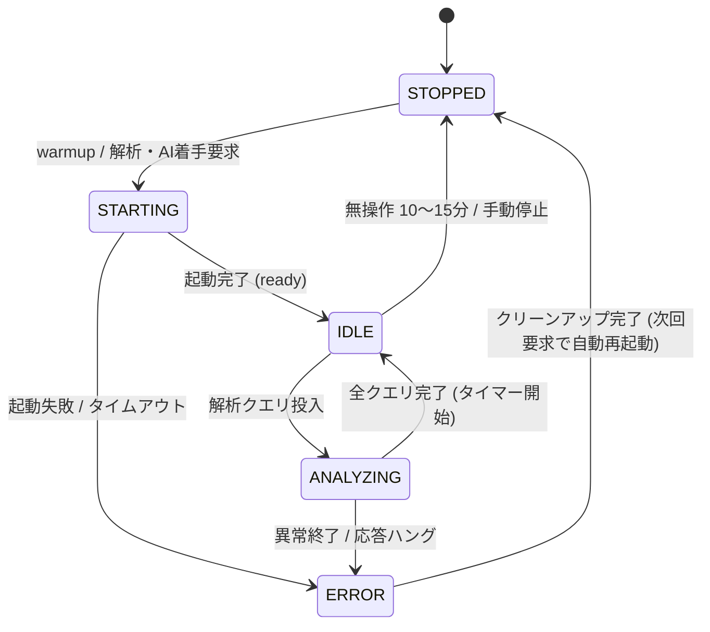

# スマホ・タブレット対応「Web 碁盤（KataGo × Gemini）」統合設計書

> **ステータス:** 詳細設計完了（実装前・レビュー統合済み）  
> **最終更新:** 2026-11-21  
> **対象端末:** Galaxy S26 Ultra（縦画面メイン）／ Galaxy Tab（横画面＋Sペン）／ Mac mini（Apple M6 サーバー）  
> **予定配置先:** `projects/web-goban/`（※本ドキュメントは設計専用であり、実装コードは未作成）

---

## 1. コンセプト・前提環境・設計原則

### 1-1. コンセプトと狙い

**「盤面の表示と操作はスマホ・タブレット、頭脳（計算）は Mac mini の KataGo、先生（日本語解説）は Gemini」**

現在稼働中の「Chrome リモートデスクトップ ＋ KaTrain」でも対局・検討は可能ですが、以下の弱点があります。

- スマホ（19路盤）では画面が小さく、指タップでほぼ確実に1路ズレる
- 画面映像を常時ストリーミングするため通信量・バッテリー消費が大きい
- KataGo は勝率・目数・候補手はプロ超えだが、**「なぜその手が良い／悪いのか」を日本語で解説してくれない**

これらを **Tailscale ＋ 軽量 Web 碁盤（PWA） ＋ Mac mini 常駐 KataGo ＋ Gemini コーチ** の組み合わせで一気に解決します。

### 1-2. 実機確認済みの前提環境（Mac mini / Android）

本設計は `my-lab` リポジトリおよび Mac mini 実機で確認済みの既存資産をそのまま活かす前提で組んでいます。

| 要素 | 実機確認済みの構成 | 本プロジェクトでの活用 |
| :--- | :--- | :--- |
| **サーバー本体** | Mac mini（Apple M6 / メモリ 16GB / macOS、スリープ防止済） | FastAPI サーバーと KataGo の常駐・オンデマンド実行基盤 |
| **囲碁AIエンジン** | `/opt/homebrew/bin/katago`（**KataGo v1.18.2 / Metal GPU**） | Analysis Engine モード（JSON 通信）で直接連携。`-human-model` 対応確認済 |
| **導入済み強モデル** | `/opt/homebrew/share/katago/kata1-b18c384nbt-s9996604416-d4316597426.bin.gz` | 既存の KaTrain 環境とモデルを共有（二重配置不要） |
| **Python 実行環境** | `/opt/homebrew/bin/python3.12`（Python 3.12.16） | `projects/web-goban/.venv` に FastAPI / uvicorn を構築 |
| **AI 解説基盤** | `/Users/sasadayuto/.local/bin/agy`（Antigravity CLI 稼働中） | 無料 Gemini API キーの回数制限（1日20回・503エラー）を回避する初期標準プロバイダ |
| **ネットワーク** | Tailscale（Mac App Store 版 / MagicDNS `mac-mini` / 3台疎通済） | 標準 HTTP/WS（＋ `tailscale serve` HTTPS 化）で外出先からも直結 |
| **クライアント端末** | Galaxy S26 Ultra（縦・片手）／ Galaxy Tab（横・Sペン）／ Samsung ブラウザ | レスポンシブ Web アプリ（ホーム画面追加で PWA 化） |
| **既存稼働サービス** | `music-automation` / `discord-ai-agent`（`launchd` 常駐） / `KaTrain`（手動起動） | ポート・プロセス分離およびメモリ競合回避を設計に織り込み済み |

### 1-3. 設計上の5大原則

1. **ネットワーク非依存（将来の引っ越し対応）：** すべて標準の HTTP / WebSocket および相対 URL で設計し、将来 Tailscale から ZeroTier や Cloudflare Tunnel へ乗り換えてもアプリ改修ゼロで動くようにする。
2. **ビルド不要のシンプル構成：** フロントエンドは複雑な Node.js / React ビルド環境を持たず、素の **HTML + CSS + Vanilla JS（Canvas / SVG）** で構築する。これにより保守性が高まり、Discord `#gemini-agent` からの小改修も即座に反映できる。
3. **単一ソースの原則（Single Source of Truth）：** 囲碁のルール判定（コウ・自殺手・打ち上げ・SGF 分岐木）はサーバー（Python）を唯一の正とし、フロントとバックエンドの二重実装バグを防ぐ。
4. **事実ベース解説（ハルシネーション抑止）：** Gemini に盤面を直接読ませず、KataGo と Python が確定させた数値・地合い差分・戦術事実だけを構造化 JSON で渡して「日本語への翻訳・教育的整理」に専念させる。
5. **省電力と既存環境共存：** 軽量な FastAPI のみ常駐させ、重い KataGo は「使う時だけ自動起動・無操作 10〜15 分で自動停止」とすることで、Mac mini の消費電力と `KaTrain` 同時利用時のメモリ圧迫を防ぐ。

### 1-4. 設計レビュー・統合で確定した重要判断（要点）

複数視点（UI/UX・バックエンド技術・Gemini コーチ）の案を突合し、以下の矛盾・落とし穴を設計段階で解消しました。

| 論点 | 検討された選択肢 | 統合設計での最終採用方針 |
| :--- | :--- | :--- |
| **ルール判定の配置 vs オフライン閲覧** | JS 側にも完全なルール判定を持つ vs サーバー単独に絞る | **Phase 1 はサーバー単独（単一ソース）** でバグを根絶。将来のオフライン閲覧（Phase 3）は「各ノードに打ち上げ石リストを保存した再生専用スナップショット」を IndexedDB へキャッシュし、**ルール二重実装なしでオフライン棋譜再生を実現**する。 |
| **悪手・疑問手の自動判定基準** | 勝率下落（-10%等）中心 vs 目数損（`scoreLoss`）中心 | **目数損（`scoreLoss`）主軸＋勝率補正＋大差局面抑制** に統一。大差局面（勝率97%超）での過剰マークや、超接戦での微差の過剰批判を防ぐ。 |
| **データ保存先（DB 分離 vs 統合）** | 棋譜用 DB とコーチキャッシュ用 DB を別々にする vs 1本化 | **標準 `.sgf` 原本（ファイル）＋ 単一 SQLite（`goban.db`）** のハイブリッド構成に統一。キャッシュ・悪手ドリル・棋風統計を一貫管理する。 |
| **Gemini の呼び出し経路** | 無料 Gemini API キー vs `agy` CLI vs 課金 API | 無料 API キーは実績上不安定なため、**プラガブル `CoachProvider`** を採用。初期は追加費用ゼロの **`agy` CLI（空フォルダ隔離＋省思考フラグ）** で動かし、速度重視時は `.env` 切替のみで課金版 Gemini API（Flash 系）へ移行可能にする。 |
| **Samsung ブラウザの PWA 制約** | `http://mac-mini:8090` のまま使う vs HTTPS 化 | 平文 HTTP では Service Worker や完全全画面 PWA・カメラ/クリップボードが制限されるため、**初回疎通は HTTP → 本運用は Mac App Store 版 Tailscale の `tailscale serve` による正規 HTTPS/WSS 化** の2段階導入を標準とする。 |

---

## 2. システム全体像（アーキテクチャ＆データ設計）

### 2-1. 全体構成図

```text
[Galaxy S26 Ultra (縦・片手)] / [Galaxy Tab (横・Sペン)]
  │ Samsung ブラウザ（HTTPS PWA：アドレスバーなし全画面）
  │ 送受信は「着手座標・解析数値・解説テキスト」の軽量データのみ
  ▼  Tailscale 暗号化トンネル（本運用: tailscale serve による HTTPS / WSS）
[Mac mini (Apple M6 / 16GB / 常時稼働)]
  ├─ Webサーバー：FastAPI + uvicorn（Python 3.12 / ポート 8090 / --workers 1 / launchd常駐）
  │    ├─ 静的フロント配信（HTML / CSS / Vanilla JS / 2層Canvas + SVG）
  │    ├─ REST API（棋譜管理・エンジン制御・Geminiコーチ3機能）
  │    ├─ WebSocket API（盤面操作・KataGo リアルタイム途中経過プッシュ）
  │    ├─ Go ルールエンジン＆SGF木管理（唯一の正 / Single Source of Truth）
  │    └─ GoFactBridge（KataGo数値 → 9エリア地合い差分・戦術事実JSON 変換）
  │
  ├─ 思考エンジン：KataGo v1.18.2（Homebrew Metal GPU・オンデマンド起動＆自動停止）
  │    └─ Analysis Engine モード（stdin/stdout NDJSON 通信・最大4MBバッファ）
  │
  ├─ 解説エンジン：CoachProvider（プラガブル抽象層）
  │    ├─ [初期標準] AgyCliProvider（agy CLI / 専用空ディレクトリ隔離実行）
  │    └─ [高速切替] GeminiApiProvider（従量課金 Flash 系・.env で即切替）
  │
  └─ 永続化ストレージ（projects/web-goban/data/）
       ├─ 標準 .sgf 原本ファイル（KaTrain 等でもそのまま開ける資産）
       ├─ SQLite DB（goban.db：棋譜索引・解析キャッシュ・解説キャッシュ・ドリル）
       └─ Markdown 振り返りレポート（任意で Discord Webhook 自動投稿）
```

### 2-2. 予定ディレクトリ構成（`projects/web-goban/`）

```text
projects/web-goban/
├── config/
│   └── katago_analysis.cfg       # Git管理：Apple M6 / 16GB 向け KataGo 設定
├── app/                          # Git管理：FastAPI バックエンド一式
│   ├── main.py                   # アプリ入口・lifespan（子プロセス確実終了）
│   ├── coords.py                 # 座標変換の一元管理（GTP / SGF / ownership / 内部座標）
│   ├── rules.py                  # 盤面ルール判定・SGF木構造管理
│   ├── katago_engine.py          # Analysis Engine 管理（Lazy Start・キャンセル・監視）
│   ├── fact_bridge.py            # KataGo数値 → 構造化ファクトJSON（Phase 2）
│   ├── coach_provider.py         # AgyCli / GeminiApi 抽象層（Phase 2）
│   └── db.py                     # SQLite（WALモード）操作
├── static/                       # Git管理：ビルド不要のフロントエンド一式
│   ├── index.html
│   ├── manifest.webmanifest      # PWA 設定
│   ├── sw.js                     # Service Worker（キャッシュ・再接続補助）
│   ├── css/                      # レスポンシブ・ダーク基調スタイル
│   └── js/                       # 2層Canvas盤面・誤タップ防止・WS通信・SVGグラフ
├── com.mylab.web-goban.plist     # Git管理：launchd 常駐設定テンプレート
├── requirements.txt              # Git管理：FastAPI / uvicorn / sgfmill 等
├── .coach-sandbox/               # agy CLI 隔離用空フォルダ（AGENTS.md 影響遮断）
├── .env                          # .gitignore対象：プロバイダ設定・APIキー・Webhook等
└── data/                         # .gitignore対象：ユーザー実行データ一式
    ├── sgf/YYYY/MM/<uuid>.sgf    # 棋譜原本（標準 SGF 形式）
    ├── reports/                  # 1局振り返りレポート（Markdown 形式）
    ├── db/goban.db               # SQLite 単一 DB（WAL モード）
    └── logs/                     # server.log / server.error.log / katago/
```

### 2-3. データ永続化ハイブリッド設計（`.sgf` ＋ 単一 SQLite）

- **棋譜の正本は標準 `.sgf` ファイル：** 特定ツールに閉じ込めず、Finder や `KaTrain` でもそのまま開ける標準資産として保存する。重い KataGo 数値配列（361交点の `ownership` や候補手リスト）は `.sgf` へ直接埋め込まず、人間向けの総評や悪手解説コメント（`C[...]`）のみ任意で書き戻す。
- **高速検索・キャッシュ・上達データは `goban.db`（SQLite WAL モード）に一元化：**
  - `sgf_records`: 棋譜ID（UUID）、タイトル、対局日、盤サイズ、手数、自分色、結果、タグ、`.sgf` 相対パス、フェーズ別平均損目サマリー
  - `analysis_cache`: `(position_hash, rules, komi, visits)` ごとの確定 KataGo 評価値（`rootInfo`, 上位 `moveInfos`, `ownership`）。同じ局面へ戻った際に再計算をゼロ化
  - `coach_cache`: `(position_hash, target_move, coach_mode, skill_level, prompt_version)` をキーにした Gemini 解説キャッシュ（Phase 2）
  - `drill_questions`: 悪手リベンジ・ドリル用の出題局面・正解基準・復習スケジュール（Phase 3）

### 2-4. 盤面ルール・SGF 木構造の責務分担

| 責務 | FastAPI サーバー（唯一の正） | フロントエンド（Vanilla JS） |
| :--- | :--- | :--- |
| **ルール判定** | 自殺手・単コウ（必要に応じスーパーコウ）・石の打ち上げ・アゲハマ・置き石・連続パス終局・簡易整地を厳密判定 | 空点チェックなどの明白な UI ガードのみ（二重実装しない） |
| **着手レスポンス** | Tailscale 内で約 5〜20ms で `move_accepted` を返却 | 確定タップ時に即時仮描画し、`move_accepted` で確定、`move_rejected` なら消去＋理由トースト表示 |
| **SGF 分岐木** | 全ノードの木構造を保持し、フラット化したツリー情報を配信 | ツリー表示と `navigate` 送信のみ担当 |
| **オフライン閲覧（Phase 3）** | 各ノードに「着手座標＋その手で打ち上げた石座標」を付与して配信 | IndexedDB 保存済みの棋譜を「閲覧・再生専用」として手数移動のみオフライン動作 |

---

## 3. UI/UX・画面・誤タップ防止・PWA 設計

### 3-1. 端末別ワイヤーフレーム

#### ① Galaxy S26 Ultra（縦画面・片手／通勤利用メイン）

盤面を幅 100% の正方形で最大確保し、親指の届く画面下部 35% に主要操作を集約します。**「通常時」と「仮置き中」でアクションバーの高さを 52px に完全固定**し、操作時に盤面が上下へガタつくレイアウトシフトをゼロにします。

```text
+------------------------------------------+  <- env(safe-area-inset-top)
| 🟢 124手目(黒番)  [■■■■■■■□□□] 黒+2.4目 ⚙ |  <- [1] 上部ステータスバー (48px)
| (再接続・オフライン時のみ極薄バナー 28px)    |  <- [1b] 条件付き通信バナー
+------------------------------------------+
|  (分岐中のみ: 🌿分岐 +3手 [本譜へ戻る])     |  <- 条件付き分岐バッジ
|    A B C D E F G H J K L M N O P Q R S T |
| 19 . . . . . . . . . . . . . . . . . . . |
|  :                                       |
|  :          [ 19路盤 Canvas ]            |  <- [2] 19路盤エリア (幅100%・1:1)
|  :        (2層Canvas / 高DPI対応)        |     ※左右に14〜16pxの安全余白兼座標帯
|  :             (仮置き石 ◉)              |     ※ズーム時のみ右上に [🔍100%] 表示
|  1 . . . . . . . . . . . . . . . . . . . |
+------------------------------------------+
| [通常時] 最善 Q14 (+2.4目/54%) | 仮置き   |  <- [3] 状態連動アクションバー (52px固定)
| [仮置き] 黒 Q14  [ ✕ 取消 ]  [ ✓ 着手確定 ]|     ※利き手設定で [✓] 位置を左右反転可
+------------------------------------------+
|  ◀戻る   ▶進む   ✨検討ON  📊詳細   ☰Menu |  <- [4] 下部ツールバー (56px + safe-area)
+------------------------------------------+
                   ▲
           [📊詳細]タップ / 上スワイプで展開
+------------------------------------------+
| ═════════ (ドラッグハンドル) ═══════════ |  <- [5] 展開式ボトムシート (オーバーレイ)
| [ 候補手 ] [ 勝率グラフ ] [ 🤖Gemini ] [分岐]|     高さ: 閉 / ハーフ(45dvh) / フル(80dvh)
| ---------------------------------------- |
| 1. 🔵 Q14  54.2%  +2.4目  (840v) [読み筋▶]|     ※候補手タップ時はシートを自動縮小し、
| 2. 🟢 R10  51.8%  +1.9目  (420v) [読み筋▶]|       上部盤面にPV番号プレビューを表示
| 3. 🟡 D4   49.5%  +1.1目  (180v) [読み筋▶]|
+------------------------------------------+
```

- **AI 対局モード時の下部ボタン連動：** `✨検討ON` を `💡ヒント`（Phase 2 で方針ヒント連動）に切替え、アクションバー通常時に `パス`・`AI着手`・`待った` を配置します。

#### ② Galaxy Tab（横画面・2カラム・じっくり検討／対局・Sペン最適化）

```text
+--------------------------------------------------+--------------------------+
| 🟢 124手目(黒番)  [■■■■■■■■□□] 黒+2.4目   ☰Menu | [勝率/目数] 切替  地合い  | <- 48px
+--------------------------------------------------+--------------------------+
|                                                  | 100%                     |
|                                                  |  50% ----/\---🔴-\-----  | <- 勝率/目数グラフ
|               [ 19路盤 Canvas ]                  |   0%          ^          |    (高さ 約22%)
|         左カラム (約65%・正方形最大化)            |      1       60      124 |    タップ/ドラッグ移動
|                                                  +--------------------------+
|     ・Sペンホバー: 候補手上で即PV番号プレビュー    | [候補手] [🤖Gemini] [対局]| <- タブバー (44px)
|     ・Sペンタップ: 1タップ直接着手(自動判別)       | ------------------------ |
|     ・指タップ: 誤爆防止の仮置き(設定で切替可)     | 1.🔵 Q14 54% +2.4 (840v) | <- スクロール可能
|                                                  | 2.🟢 R10 52% +1.9 (420v) |    パネル領域
|                                                  | 3.🟡 D4  50% +1.1 (180v) |    (残り高さ)
|                                                  | ------------------------ |
|                                                  | [分岐: 本譜 / 変化A(45手)]|
+--------------------------------------------------+--------------------------+
| [盤面下部ミニバー(仮置き時のみ確定UIを表示)]       | |◀ ◀◀  ◀  ▶  ▶▶ ▶|  ✨検討| <- 操作バー (52px)
+--------------------------------------------------+--------------------------+
```

- **Galaxy Tab / Sペン専用最適化（標準 `PointerEvent` のみで実現）：**
  - **Air View ホバー PV プレビュー：** `pointerType === 'pen'`（または PC の `mouse`）で候補手の上にペン先を近づけるだけで、タップせず盤面に PV 予想手順（1〜8手）を即時プレビュー。
  - **入力デバイスの自動判別：** `pen` / `mouse` は精度が高いため「1タップ直接着手」、`touch`（指）は「仮置き＋確定」を自動適用（設定で「自動 / 常に仮置き / 常に直接」を切替可能）。
  - **簡易パームリジェクション：** Sペンがホバー／接触中および離脱後 `300ms` 以内の `touch` イベントを盤面上で無視し、画面に手を置いて操作する際の誤反応を防止。

### 3-2. レスポンシブ設計・安全領域・タップ基準

| 項目 | 設計基準 | 意図 |
| :--- | :--- | :--- |
| **レイアウト切替** | デフォルトは1カラム縦。`@media (min-width: 900px) and (orientation: landscape)` または `(min-width: 1024px)` で2カラム横へ切替 | Galaxy S26 Ultra 縦・Galaxy Tab 縦は1カラム、Galaxy Tab 横（右カラム `clamp(320px, 35vw, 440px)`）と PC は2カラム |
| **動的ビューポート** | `height: 100vh; height: 100dvh;` | Samsung ブラウザの上下バー伸縮で下部ボタンが切れる現象を防止 |
| **安全領域** | `viewport-fit=cover` ＋ `env(safe-area-inset-*)` | パンチホール・Android 下部ジェスチャーバーとの重なり回避 |
| **最小タップ領域** | **推奨 48×48 CSS px（最小 44×44px）**、ボタン間隔 **8px 以上** | 電車や社バス移動中の片手操作でも押し間違えないサイズ |

### 3-3. 19路盤の誤タップ防止 UX（最重要）

Galaxy S26 Ultra の画面幅（約 384〜412 CSS px）に 19路盤を描くと **1交点の間隔は約 18〜20px** しかなく、指の接触幅（約 45px）の半分以下です。これを以下の仕組みで確実に解決します。

1. **仮置き（ゴースト石）＋上方向オフセットドラッグ微調整：**
   - 1タップ目で最寄り空点に半透明ゴースト石＋淡い縦横十字ガイド＋座標（例：`黒 Q14`）を表示。
   - そのまま指を滑らせると、照準位置を **指の接触点から上方向へ約 48px オフセット** して追従（盤面上端3路付近では画面外に出ないよう自動減衰）。自分の指で狙う交点が隠れず、1路単位でピタリと合わせられます。
2. **誤確定を防ぐ確定ルール：**
   - デフォルトは **下部アクションバーの `[✓ 着手確定]` ボタン押下のみ** で確定（「仮置き石の再タップで確定」は1路隣へ修正しようとして誤確定する事故が多いためデフォルト OFF、設定で ON 可能）。
3. **ズーム・パンと照準ドラッグの明確な分離：**
   - `zoom === 1.0x` 時の1本指ドラッグ ＝ **ゴースト石の照準微調整**。
   - `zoom > 1.0x`（最大 `2.5x`）時の1本指ドラッグ ＝ **盤面のパン移動**（拡大中に位置を変えたい時はタップ）。
   - 2本指ピンチ中は仮置き石を消さずに拡大確認でき、ピンチ終了後 `200ms` は誤タップ無効化。拡大中のみ盤面右上に `[🔍 100%]` リセットボタンを表示。
4. **Samsung ブラウザ特有のジェスチャー干渉対策：**
   - Pull-to-Refresh 誤発動防止：`html, body { overscroll-behavior: none; }`
   - ページ全体の勝手な拡大防止：盤面コンテナに `touch-action: none;`
   - 長押しメニュー／テキスト選択抑止：`user-select: none; -webkit-touch-callout: none;` ＋ `contextmenu` 無効化
   - Android の画面端「戻る」スワイプ誤爆軽減：盤面左右に **14〜16px の座標帯兼安全余白** を設け、さらに `history.pushState` / `popstate` でボトムシート表示中の戻る操作を「シートを閉じる」動作へ吸収。

### 3-4. 視覚デザイン・検討情報の見せ方

- **2層 Canvas ＋ インライン SVG 構成：**
  - **下層（静的 Canvas）：** 木目背景・罫線・星・座標・確定石。着手やズーム時のみ再描画しスマホの電池を節約。
  - **上層（動的 Canvas）：** 地合いヒートマップ・候補手マーカー・PV 番号仮石・ゴースト石と十字ガイド。高頻度更新でも 60fps 維持。
  - 高DPI対応：`dpr = Math.min(window.devicePixelRatio || 1, 3)` で内部解像度を拡大し、文字と罫線の滲みを防ぐ。
  - **勝率／目数推移グラフ：** インライン `<svg>` で描画し、悪手バッジのクリック・ドラッグによる手数ジャンプを軽快に実装。
- **色覚多様性（CUD）配慮の候補手マーカー（色＋枠形状の二重表現）：**
  - **最善手（1位 / 差 0.3目以内）：** 青 `#1565C0`（白太文字）＋ **二重リング枠**
  - **有力手（差 0.3〜1.0目）：** 深緑 `#00897B`（白文字）＋ **太実線リング**
  - **次点（差 1.0〜2.5目）：** アンバー `#F59E0B`（濃黒文字）＋ **やや小さめの円**
  - スマホ盤面上は文字潰れ防止のため **最大5手・1行のみ表示**（デフォルト：`最善からの損目数` または `目数差`、設定で `勝率%` / `順位のみ` に切替）。詳細（探索数 visits 等）はボトムシート／右カラムの一覧で表示。
- **地合いヒートマップ＆死活マーク（`ownership` 活用）：**
  - `|ownership| >= 0.25` の交点のみ、石の下レイヤーへ半透明スクエア（最大 `alpha: 0.55`）で白黒表示。石の色と `ownership` の符号が逆（死にかけ）の石には薄い `×` マークを表示（ワンタップ ON/OFF、デフォルト OFF）。
- **軽量分岐（変化図）ナビゲーション：**
  - 複雑なツリー編集UIは避け、本譜から外れている間だけ盤面上端に **`🌿 分岐中（45手目〜 +3手） [本譜へ戻る]`** バッジを表示。分岐点では控えめな `A` / `B` 記号と分岐リストからの切替に対応。

### 3-5. Samsung ブラウザ向け PWA ＆ HTTPS 化（2段階導入）

#### なぜ本運用では HTTPS 化が必要か？
`http://mac-mini:8090` のような平文 HTTP（`localhost` 以外）は Samsung ブラウザで **非セキュアコンテキスト** と判定され、以下の機能が制限されます。
- Service Worker が動かず、アドレスバーが消える完全な PWA（WebAPK）にならない
- クリップボード（SGF コピー）、Wake Lock（対局中の画面消灯防止）、Phase 3 のカメラ撮影がブロックされる

#### 推奨 2段階導入ステップ（アプリ改修ゼロ）
1. **Step A（初回疎通テスト）：** まず `http://mac-mini:8090` で動作を確認。
2. **Step B（本運用・完全 PWA 化）：** Tailscale 管理画面で MagicDNS ＋ **HTTPS Certificates** を有効化し、Mac mini 側で Mac App Store 版 Tailscale の CLI から以下を1回だけ実行します。
   - `/Applications/Tailscale.app/Contents/MacOS/Tailscale serve --bg http://127.0.0.1:8090`
   - これにより `https://mac-mini.<tailnet名>.ts.net/` が正規 Let's Encrypt 証明書付き HTTPS / WSS で自動公開され、Samsung ブラウザのアドレスバー右端「↓（インストール）」から完全全画面アプリ化できます。
   - 将来 Cloudflare Tunnel 等へ乗り換えても、アプリ側は相対パス＋プロトコル自動判定（`https:` → `wss:`）のためコード修正は一切不要です。

#### `manifest.webmanifest` と通信断・回線切替 UX
- **マニフェスト要点：** `display: "standalone"`（ステータスバーの時計・電池は残す）、`orientation: "any"`（スマホ縦・タブ横の両対応）、ダーク基調 `theme_color: "#1A1D21"`（夜間の白フラッシュ防止）、`maskable` アイコン対応。
- **回線切替・自動再接続 UX：** 上部バー左端に極小ドット（🟢接続中 / 🟡再接続中 / 🔴オフライン）を常設。`visibilitychange`（スリープ復帰）と `online` 発火時は待ち時間 0 秒で即再接続し、失敗時は指数バックオフ（`0.5s → 1s → 2s → 最大 15s`）＋盤面を隠さない 28px の再接続バナーを表示します。

---

## 4. バックエンド＆KataGo Analysis Engine 技術仕様

### 4-1. KataGo 起動仕様と Apple M6 / 16GB 向けチューニング

```text
/opt/homebrew/bin/katago analysis \
  -config /Users/sasadayuto/my-lab/projects/web-goban/config/katago_analysis.cfg \
  -model /opt/homebrew/share/katago/kata1-b18c384nbt-s9996604416-d4316597426.bin.gz \
  -quit-without-waiting
```
※ `-quit-without-waiting` により、`stdin` クローズ時に未処理キューを待たず高速終了できます。Phase 3 で Human-like モデルを追加する際は `-human-model <パス>` を足すだけです。

#### `katago_analysis.cfg` 推奨値（常駐メモリ約 1.2〜1.8GB 目標・`KaTrain` 共存配慮）

| パラメータ | デフォルト値 | 推奨値 | 理由 |
| :--- | :--- | :--- | :--- |
| `reportAnalysisWinratesAs` | `BLACK` | **`BLACK`（固定）** | 内部データを常に黒視点に統一し、白番時の符号バグを根絶 |
| `numAnalysisThreads` | `2` | **`1`** | 個人利用では「今見ている1局面の応答速度」と省メモリを優先 |
| `numSearchThreadsPerAnalysisThread` | `16` | **`12`** | Apple M6 Metal GPU での応答速度と探索効率のバランス帯 |
| `nnMaxBatchSize` | `64` | **`16`** | 探索スレッド数（12）以上あれば十分。GPU バッファメモリを大幅節約 |
| `nnCacheSizePowerOfTwo` | `23` | **`20`** | $2^{20}$（約104万件）に抑え、16GB 環境でのスワップ・`KaTrain` 競合を回避 |
| `nnMutexPoolSizePowerOfTwo` | `17` | **`15`** | キャッシュサイズ `20` に合わせたロックプールサイズ |
| `maxVisits` / `analysisPVLen` | `500` / `15` | **`500` / `15`** | 既定の安全上限。用途別（対局/検討/深掘り）にクエリごとに上書き |
| `wideRootNoise` | `0.04` | **`0.04`** | 検討時に幅広い候補手を調べる設定（対局AI着手時は `0.0` で上書き） |
| `conservativePass` / `preventCleanupPhase` | `true` / `true` | **`true` / `true`** | 日本ルールでの不自然なクリーンアップ手順を防止 |
| `warnUnusedFields` | 未設定 | **`true`** | リクエスト JSON のキー名タイポを stderr 警告で早期検知 |
| `logDir` / `logToStderr` | `analysis_logs` | `data/logs/katago` / `true` | ログファイル無限増殖を防ぎ、起動時に直近5世代のみ保持 |

### 4-2. KataGo Analysis Engine JSON 通信＆3段キャンセル制御

FastAPI と KataGo は `stdin` / `stdout` 経由の **NDJSON（1行1JSON・末尾 `\n` 必須）** で通信します。

#### 解析リクエスト JSON 例（FastAPI → KataGo `stdin`）
```json
{
  "id": "q-000142-v45",
  "moves": [["B", "Q16"], ["W", "D4"], ["B", "Q4"], ["W", "pass"]],
  "initialStones": [],
  "initialPlayer": "B",
  "rules": "japanese",
  "komi": 6.5,
  "boardXSize": 19,
  "boardYSize": 19,
  "analyzeTurns": [4],
  "maxVisits": 500,
  "includeOwnership": true,
  "includePVVisits": true,
  "reportDuringSearchEvery": 0.3,
  "priority": 10,
  "overrideSettings": {
    "wideRootNoise": 0.04
  }
}
```
- **優先度（`priority`）設計：** 対局 AI 着手 `20` ＞ リアルタイム検討 `10` ＞ 精密検討 `5` ＞ 1局一括検討 `-10`。対話操作が一括検討に待たされないようにする。
- **途中経過ストリーミング：** `reportDuringSearchEvery: 0.3` により、`isDuringSearch: true` の途中経過が 0.3 秒ごとに届き、最終的に `isDuringSearch: false` で確定。`noResults: true` の応答はキャンセル由来のためキャッシュせず破棄する。

#### 戻る／進む連打対策：3段キャンセル制御
1. **入口デバウンス（120〜150ms）：** 連打中は盤面描画のみ即更新し、操作が止まってから KataGo へ投げる。
2. **明示的単発キャンセル：** 新クエリ送信直前に旧リアルタイムクエリへ `{"id": "term-...", "action": "terminate", "terminateId": "旧id"}` を送信（一括検討を止めずにリアルタイム検討だけ中止できる。全停止時のみ `terminate_all`）。
3. **遅延到着フレーム破棄：** キャンセル直後に届く旧クエリの最終フレームは `active_interactive_query_id` と照合して FastAPI 側で即破棄。

### 4-3. フロントエンド ↔ FastAPI 通信契約（REST + WebSocket）

#### REST API エンドポイント（ベースパス `/api/v1`）

| カテゴリ | メソッド・パス | 概要 |
| :--- | :--- | :--- |
| **ヘルス・エンジン** | `GET /api/v1/health` | サーバー生存確認・バージョン |
| | `GET /api/v1/engine/status` | KataGo 状態（`STOPPED`/`STARTING`/`IDLE`/`ANALYZING`/`ERROR`）、アイドル残秒数、別 KataGo（`KaTrain` 等）稼働検知 |
| | `POST /api/v1/engine/warmup` | ページ表示直後の先読み起動（体感待ち時間ゼロ化） |
| | `POST /api/v1/engine/stop` | KataGo 手動即時停止（`KaTrain` を使いたい時の即時解放用） |
| **セッション・対局** | `POST /api/v1/games` | 新規対局／検討セッション作成（盤サイズ・ルール・コミ・置き石・モード） |
| | `GET /api/v1/games/{game_id}` | セッション全状態（SGF木・現在ノード・キャッシュ済み解析）取得 |
| | `POST /api/v1/games/{game_id}/import-sgf` | SGF テキスト／ファイル読込 |
| | `GET /api/v1/games/{game_id}/export-sgf` | 現在の棋譜（分岐・コメント含む）を `.sgf` 出力 |
| **棋譜ライブラリ** | `GET / POST /api/v1/sgf` | 保存済み棋譜の一覧検索・新規/上書き保存 |
| | `GET / PATCH / DELETE /api/v1/sgf/{sgf_id}` | 読込・タイトル/タグ編集・削除 |
| **Gemini コーチ（Phase 2）** | `POST /api/v1/games/{game_id}/coach/explain` | 機能①：「なぜ悪手？」ワンタップ解説（SSE または JSON） |
| | `POST /api/v1/games/{game_id}/coach/hint` | 機能②：答えを言わない方針ヒント（Lv1〜Lv3 一括生成） |
| | `POST /api/v1/games/{game_id}/coach/review` | 機能③：1局振り返りレポート生成＋保存＋任意 Discord 通知 |

#### WebSocket イベント仕様（`ws(s)://<host>/ws/games/{game_id}`）
共通エンベロープ：`{"type": "<event_type>", "state_version": <int>, "payload": {...}}`

- **Client → Server：** `sync_request`（再接続同期）、`play_move`（座標・`expected_version`）、`navigate`（手数/分岐移動）、`set_mode`（対局/検討・自動解析ON/OFF・AI強さ）、`request_analysis`（深掘り検討）、`request_full_review`（1局一括検討）、`cancel_analysis`、`request_ai_move`、`undo`、`resign`、`ping`
- **Server → Client：** `state_sync`（全状態復元）、`move_accepted`（新 `state_version`・打ち上げ石リスト・アゲハマ）、`move_rejected`（`OCCUPIED`/`SUICIDE`/`KO`/`VERSION_CONFLICT`）、`analysis_update`（途中経過・確定結果）、`ai_move`、`engine_status`、`error`、`pong`
- **古い応答の破棄：** フロントは `analysis_update` 受信時、`node_id` 不一致または `state_version` が古いフレームを無条件で破棄します。

### 4-4. 対局モードの AI 強さ調整設計

KataGo Analysis Engine は候補手リスト（`moveInfos`）を返すため、**対局 AI の1手選択ロジックは FastAPI（Python）側** に実装します。

- **Phase 1（導入済み `kata1-b18c384nbt` のみで実現）：**
  - プリセット（15級 / 10級 / 5級 / 初段 / 五段 / 全力）ごとに `maxVisits`（30〜300）と **損失フィルタ付き Softmax 温度サンプリング** を組み合わせる。
  - 級位プリセットでは「最善手から `-0.5〜-4.0目` 程度の候補手（ただし自滅的大悪手は除外）」を確率選択することで、単純な `maxVisits=1` より遥かに自然な手加減を実現。終盤の大差自動投了設定も用意。
- **Phase 3（Human-like モデル導入後）：**
  - `-human-model` を追加し、`overrideSettings` に `humanSLProfile`（例：`rank_10k`〜`rank_9d`）を指定することで、プロの強モデルを裏で維持したまま「人間らしい棋力・棋風」での対局に進化させます。

### 4-5. 省電力・オンデマンド起動（Lazy Start）＆ `launchd` 常駐



- **初回起動 2〜3 秒の体感待ち時間対策：** ブラウザを開いた瞬間に `POST /api/v1/engine/warmup` を非同期発火し、棋譜選択や設定の間に裏で起動完了させます。`STARTING` 中の要求はエラーにせず待機キューへ入れ、UI に「AIエンジン準備中…」を表示します。
- **`launchd` 常駐設定（`~/Library/LaunchAgents/com.mylab.web-goban.plist`）の要点：**
  - 既存 `com.mylab.discord-ai-agent.plist` と完全に運用ルールを統一（`RunAtLoad: true`, `KeepAlive: true`, `ThrottleInterval: 5`）。
  - **必須オプション：`--workers 1` 厳守**（複数ワーカーにすると KataGo が重複起動しメモリ枯渇＋セッション不整合が起きる）。
  - **必須環境変数：** `HOME=/Users/sasadayuto`（macOS Metal シェーダキャッシュ活用に必須。未設定だと毎回起動が極端に遅くなる）および `PATH=/Users/sasadayuto/.local/bin:/opt/homebrew/bin:...`（`katago` と `agy` 検出用）。
  - **リッスン先：** `.env` の `BIND_HOST` で管理（`tailscale serve` 本運用時は `127.0.0.1`、初期 HTTP テスト時は `0.0.0.0`）。秘密情報は plist に書かず `.env` 限定。

### 4-6. 実装前に必ず潰すべき8つの技術的落とし穴（Pitfalls チェックリスト）

| # | 落とし穴（Pitfall） | 起きる不具合 | 必須対策 |
| :-: | :--- | :--- | :--- |
| **1** | **`asyncio` サブプロセスの `stdout` 64KB 制限** | `includeOwnership: true` 付き応答が 64KB を超え、`readline()` が `LimitOverrunError` で即死する | `create_subprocess_exec` 生成時に **`limit=4 * 1024 * 1024`（4MB）** を必ず明示指定 |
| **2** | **座標系とパス表現の混在** | GTP（KataGo）は **`I` を飛ばす**（`A-H, J-T`・左下原点）、SGF は **`i` を飛ばさない**（`a-s`・左上原点）、`ownership` は `A19→T1` 行優先、パスは `"pass"` / `""` / `"tt"` とバラバラ | `app/coords.py` 1箇所に内部座標 `(x, y)` と全変換を集約し、9/13/19路・`I/J` 境界・パスの往復テストを実装初期に必須作成 |
| **3** | **勝率・目数差の符号ミス** | 白番時に勝率グラフや悪手判定が逆転する | KataGo 側は `reportAnalysisWinratesAs = BLACK` 固定。内部計算はすべて黒視点不変とし、悪手損失計算はサーバー側ヘルパー1箇所に一元化 |
| **4** | **`stderr` パイプ詰まりによるデッドロック** | `stderr=PIPE` を読まず放置すると 64KB 満杯時に KataGo が無言で完全停止 | 起動直後に `stderr` を継続ドレイン＆ログ記録する専用 `asyncio.Task` を常時稼働 |
| **5** | **ゾンビプロセス化・応答ハング** | サーバー再起動後も裏で KataGo が 1.5GB 食い続ける／応答停止で画面が固まる | FastAPI `lifespan` 終了フックで確実に終了（`stdin.close`→`SIGTERM`→`SIGKILL`）＋ `proc.wait()` 監視＆クエリ単位タイムアウト（30〜60秒） |
| **6** | **置き石局のコミ・手番漏れ** | 置き石2子以上なのに `komi: 6.5` / `initialPlayer: "B"` のまま送られ評価が破綻 | 置き石2子以上の新規作成時は自動で `komi: 0.5`・`initialPlayer: "W"` をデフォルト適用 |
| **7** | **ローカル／Tailscale 内のセキュリティ** | 他タブの悪性ページから WS 接続される（CSWSH）／SGF ファイル名でのパストラバーサル | CORS `*` 禁止、WS 接続時の `Origin` 検証、SGF 保存名は UUID 固定＋`is_relative_to(SGF_ROOT)` 検証、アップロード上限 1MB |
| **8** | **`KaTrain` 手動同時起動との競合** | Metal GPU と 16GB メモリを奪い合い動作が極端に重くなる | Lazy Start＋10〜15分自動停止＋UI の「エンジン手動停止」ボタン＋`engine/status` での別 KataGo 稼働検知警告バナー |

---

## 5. Gemini 連動「AI 囲碁コーチ」設計（Phase 2）

### 5-1. 呼び出し方式の選定とプラガブル `CoachProvider` 設計

過去の検証（`ai-context/handoff-log.md`）で Google AI Studio 無料枠 `GEMINI_API_KEY` は 1日20回制限・夜間 503 エラーで実用不可と判明しています。一方、Mac mini 上の **`agy` CLI** は安定稼働中で、`--mode plan` / `--effort low` / `--disable-slash-commands` / `--output-format stream-json` を備えていることを実機確認済みです。

| 方式 | コスト | 安定性・制限 | 体感速度 | 位置づけ |
| :--- | :--- | :--- | :--- | :--- |
| **`AgyCliProvider`（`agy` CLI）** | 追加費用なし | ◎（稼働実績あり） | 中（約 3〜8秒） | **Phase 2 初期の標準プロバイダ** |
| **`GeminiApiProvider`（課金版 Flash 系）** | 極安（約0.1円/回） | ◎（制限ほぼ無関係） | **最速（1〜2.5秒）** | **高速化したい時の `.env` 1行切替枠** |
| Google AI Studio 無料枠 | 無料 | ✕（1日20回・503多発） | 不安定 | **不採用** |
| `RuleBasedFallbackProvider` | 無料 | ◎（完全オフライン） | 即時（0.01秒） | AI 通信失敗時の定型サマリー非常用 |

#### `AgyCliProvider` を囲碁コーチ用に安全・高速化する必須工夫
1. **空フォルダ隔離実行：** `projects/web-goban/.coach-sandbox/` を `cwd` に指定して起動し、`my-lab/AGENTS.md` の読み込みやファイル探索暴走を完全遮断。
2. **省思考・純応答フラグ：** `--mode plan --effort low --disable-slash-commands --output-format stream-json` を指定し、ツール呼び出しを封じて応答を高速化。
3. **同時実行制限：** `asyncio.Semaphore(2)` で連打時のプロセス増殖を防止し、新規リクエストが来たら古い未完了タスクをキャンセル。

#### キャッシュ＆2段階レスポンス UX（待たせない工夫）
- **SQLite キャッシュ（`coach_cache`）：** `(position_hash, target_move, coach_mode, skill_level, prompt_version)` でキャッシュ。同じ局面に戻った際は **0.01 秒で即時表示** し、不要な呼び出しをゼロ化。
- **Stage 1（0.1〜0.3秒・自動即時）：** KataGo の数値・悪手バッジ・候補手・地合い差分だけを表示（Gemini は自動起動しない）。
- **Stage 2（ボタン押下時のみオンデマンド）：** タップ直後に Python 事前集計の **速報1行**（例：`解析中… 実戦 R10 は -4.2目損／右上隅の地合い減少`）を 0.05 秒で先出ししつつ、Gemini の本文をストリーミング表示。

### 5-2. ハルシネーション徹底防止：`GoFactBridge`（データ翻訳ブリッジ）

Gemini 単体は碁盤の石配置を正確に読めないため、**囲碁の事実判定は 100% Python ＋ KataGo 側で確定させ、Gemini には構造化ファクト JSON だけを渡します。**

1. **局面フェーズ自動判定（19/13/9路対応）：**
   - `confirmed_ratio`（`|ownership| >= 0.85` の交点割合）と `move_ratio`（手数 ÷ `盤サイズ² × 0.7`）のハイブリッドで `opening`（序盤）／ `middlegame`（中盤）／ `endgame`（ヨセ）を判定。
2. **361交点 `ownership` 差分 → 9エリア地合い増減集約：**
   - 盤面を四隅・四辺・中央の **9エリア** に分割（19路は `1-6 / 7-13 / 14-19`）。
   - 手番目線の各交点差分 $\Delta_i = \text{sign} \times (\text{own}_{\text{after}}[i] - \text{own}_{\text{before}}[i])$（黒番 $\text{sign}=+1$、白番 $-1$）をエリア内で合計 $\sum_{i \in A} \Delta_i$ することで、各エリアの目数影響度を正確に算出（※全9エリアの合計が KataGo の目数変動と整合）。絶対値 `1.5目` 以上の上位3エリアのみ抽出してノイズ除去。
3. **石群の死活急変検出：**
   - 連結した石群（連）の平均 `ownership` が着手前後で符号反転かつ `0.6` 以上変動した場合、`{"event": "石の死活悪化", "area": "右辺", "stones_count": 4, "owner": "黒"}` として明示注入。
4. **部分ミス vs 方向違い（大局観ミス）の自動分類：**
   - 実戦手と最善手の距離（マンハッタン距離 `<= 4` かつ同エリア → `local_shape_or_tactics`、距離 `>= 6` または別エリア → `direction_of_play`）に加え、アゲハマ・アタリ・コウ・接触有無を Python ルールエンジンから確定付与。
5. **3層ハルシネーション防御：**
   - **入力層：** 生の盤面図は渡さずファクト JSON のみ渡す。大差局面フラグ `is_decided_game`（勝率 95%以上/5%以下 かつ 15目以上差）を明示。
   - **プロンプト層：** 座標は入力 JSON 内の座標のみ引用可。ファクトにないシチョウ・コウ材・二眼等の断定を禁止。
   - **出力検証層（Python ポストチェック）：** 出力テキストから `[A-HJ-T](?:1[0-9]|[1-9])` を抽出し、入力ホワイトリスト外の捏造座標が含まれていれば自動リトライ／安全文言置換。

### 5-3. 悪手・好手の統一判定基準＆棋力レベル設定

勝率だけで判定すると大差局面で見逃し・超接戦で過剰批判が起きるため、**目数損（`scoreLoss`）主軸のハイブリッド判定** をグラフ表示・コーチ解説・悪手ドリル共通の統一基準とします。

| 判定ラベル | グラフ／一覧バッジ | 通常局面での条件 | 大差局面（勝率>97% or <3%） |
| :--- | :---: | :--- | :--- |
| **大悪手（Blunder）** | 🔴 `-X.X目` | `scoreLoss >= 5.0` または（`>= 3.0` かつ勝率 `-20%` 以上） | `scoreLoss >= 8.0` のみ疑問手扱い |
| **悪手（Mistake）** | 🟠 `-X.X目` | `scoreLoss >= 2.5` または（`>= 1.5` かつ勝率 `-15%` 以上） | マーク非表示（手動解説は可） |
| **疑問手（Inaccuracy）** | 🟡 `-X.X目` | `scoreLoss >= 1.2` | マーク非表示 |
| **好手（Good）** | 🔵 `Good!` | AI 上位2手以内で `scoreLoss <= 0.3` かつ 1位と3位の差 `>= 2.0目` | 対象外 |

- **棋力レベル設定（設定画面で切替）：**
  - `beginner`（10〜5級）：専門用語を言い換え補足、石の強弱・陣地中心、PV 1〜3手まで
  - `intermediate`（4級〜初段）：先手/後手・大場・急所・方向性中心、PV 3〜5手まで
  - `dan`（二段〜高段）：専門用語制限なし、味の違い・損得計算、PV 5〜8手まで

### 5-4. 3大コーチ機能の具体プロンプト仕様

#### 機能①：「なぜこれが悪手？」ワンタップ解説
- **入力：** `GoFactBridge` が生成した構造化 JSON（`move_number`, `phase`, `is_decided_game`, `mistake_category`, `actual_move`, `best_moves` 上位2〜3手＋PV, `area_ownership_changes`, `group_status_events`）。
- **System Prompt 要点：**
  - 渡された JSON 事実のみを根拠に解説し、JSON にない座標・手筋（シチョウ等）を捏造しない。
  - `is_decided_game: true` の時は「致命的な敗着」と誇張せず「大勢は決していますが、形・ヨセの勉強としては〜」と穏やかに表現する。
  - 棋力レベル `{skill_profile}` に合わせた語彙と長さで、指定 JSON のみを返す。
- **出力 JSON スキーマ：**
  ```json
  {
    "headline": "結論を1行（35文字以内・スマホで一目で読める要約）",
    "reasons": [
      "理由1（地合い変化や方向違いを数値・エリア根拠で説明）",
      "理由2（先手/後手や石の強弱への影響）"
    ],
    "recommended_plan": "AI最善手とPV先頭手順の狙い（2〜3文）",
    "one_point_tip": "次の実戦で意識できるひとことアドバイス（1文）"
  }
  ```

#### 機能②：「答えを言わない方針ヒント」モード（座標3重ロック）
LLM に座標を渡して「言わないで」と頼むだけでは漏洩リスクがあるため、**物理遮断を含む3重ロック** を採用します。さらに **1回の呼び出しで Lv1〜Lv3 を一括 JSON 生成してキャッシュ** することで、「もっとヒント」ボタンを待ち時間 0 秒で段階開示できます。

1. **第1ロック（物理遮断）：** Gemini に渡す JSON から座標（`Q14` 等）と `pv` を完全削除し、`best_move_area: "右上隅"`, `move_intent_tags: ["相手石への働きかけ", "先手の権利確保"]` の抽象情報だけを渡す。
2. **第2ロック（プロンプト制約）：** 座標・何線・星からの相対位置など特定しすぎる表現を禁止。
3. **第3ロック（出力フィルタ）：** 座標正規表現を検出した場合は自動マスク＆再生成。

- **4ステップ段階開示 UX：**
  - `lv1_macro`：注目すべき大きなエリア・大局観（60〜90字）
  - `lv2_strategy`：そこで採るべき方針（攻め／守り／連絡／模様制限など）
  - `lv3_narrow`：盤面上の該当エリア（4×4マス程度のぼんやりハイライト枠）を光らせつつ最後の一押しヒント
  - `Lv4（答えを見る）`：KataGo の候補手マーカーと PV を解禁

#### 機能③：「1局まるごと自動振り返りレポート」（＋SGF/MD保存＆Discord通知）
1. **Python 側事前集計：** 全手軽量解析（100〜200 visits/手、M6 Metal GPU で 1局約 15〜25秒）の結果から、**自分の手番のみ** のフェーズ別平均損目、**悪手 Top 3**（大差ガベージタイム除外・連続ミスは代表1手）、**勝敗分岐点 1手**、**好手 1〜2手** を抽出して約 2,000 文字のコンパクト JSON に圧縮。
2. **Gemini 1回呼び出し：** 「最初に必ず良かった点を褒める」「悪手 Top 3 の共通傾向から、次局で意識する重点テーマを **たった1つ** に絞る」制約で JSON 生成（`title`, `overall_summary`, `praise_points`, `turning_point_comment`, `blunder_comments`, `pattern_diagnosis`, `next_game_theme`）。
3. **3箇所への資産出力：**
   - `data/reports/YYYY-MM-DD_HHMM_<id>.md` に標準 Markdown で保存
   - 元の `.sgf`（複製可）のルートノードと悪手 Top 3 ノードへ `C[...]` コメントとして書き戻し
   - 任意トグル ON 時、既存 Discord Webhook へ 1900 文字以内の見やすいサマリー＋該当棋譜へのディープリンク URL を自動投稿
4. **おまけ機能（低コスト高満足）：** 解説カードと振り返りレポートにブラウザ標準 `Web Speech Synthesis` の **「🔊 読み上げ」ボタン** を設置（イヤホン越しにラジオ感覚で振り返り可能）。

---

## 6. Phase 3 発展構想の深掘り＆優先度マップ

「上達・楽しさインパクト」と「実装コスト・現実性」の両面で精査した拡張計画です。

### 6-1. 優先度マトリクス

| 優先順 | 機能名 | インパクト | 難易度 | 推奨時期 | 採用判断・技術的な肝 |
| :---: | :--- | :---: | :---: | :--- | :--- |
| **🥇 1** | **地合いヒートマップ＆死活マーク** | ★★★★☆ | ★☆☆☆☆ | **Phase 1.5** | 既存 `ownership` を下層描画するだけ。半日で作れて形勢判断に直結 |
| **🥈 2** | **Human-like モデル棋力別対戦** | ★★★★★ | ★★☆☆☆ | **Phase 2.5〜3 初期** | 実機 KataGo v1.18.2 の `-human-model` + `humanSLProfile` 活用。自然な人間らしい対局体験 |
| **🥉 3** | **悪手リベンジ・ドリル** | ★★★★★ | ★★★☆☆ | **Phase 3 メイン** | 社バス待ち1〜2分向け自動クイズ。**「AI 1位以外でも損失 1.0目以内なら正解」** の実践判定＋簡易忘却曲線 |
| **4** | **解説「🔊 読み上げ」ボタン** | ★★★☆☆ | ★☆☆☆☆ | **Phase 2 おまけ** | 音声構想の美味しい所取り。ブラウザ標準 TTS のみで数十分で実装可 |
| **5** | **棋風カルテ・上達グラフ** | ★★★★☆ | ★★☆☆☆ | **Phase 3 中盤** | SQLite に 5〜10局貯まった時点で序盤/中盤/ヨセの平均損目推移＋月次 Gemini 総評を表示 |
| **6** | **スクショ／カメラ盤面認識** | ★★★★☆ | ★★★〜★★★★☆ | **Phase 3 後半** | まず精度98〜99%を出せる **他アプリスクショ専用（OpenCV）＋必須ワンタップ修正UI** から着手。紙の本（OpenCV台形補正＋Gemini Vision）は第2弾 |
| **7** | **PWA オフライン棋譜閲覧** | ★★★☆☆ | ★★★☆☆ | **Phase 3 後半** | Service Worker＋IndexedDB で直近20局の「再生専用スナップショット」を同期（ルール二重実装不要） |
| **見送り** | 完全双方向・音声対局（座標音声入力） | ★★☆☆☆ | ★★★★★ | **代替案へ統合** | Android ブラウザの画面ロック停止・囲碁座標の誤認識ストレスが大きいため見送り、4位の読み上げで代替 |

### 6-2. 主要拡張機能の落とし穴と設計ポイント

- **悪手リベンジ・ドリル（通勤キラー機能）：**
  - 自動抽出条件：自分の手番・`scoreLoss >= 3.0目`・着手前勝率 `10%〜90%`・連続悪手は代表1問のみ。相手の大悪手直後など不自然な問題は「スキップ／アーカイブ」可能にする。
  - 正解判定：ユーザー着手に対し候補手上位または KataGo 100 visits（0.2秒）で真の損失を算出し、**`<= 1.0目` ⭕正解 ／ `<= 2.5目` 🔺おしい ／ `> 2.5目` ❌再挑戦** とすることで実戦納得感を高める。
  - 復習間隔（簡易 Leitner 方式）：正解で `1日 → 3日 → 7日 → 14日 → 卒業`、不正解で翌日再出題。
- **スクショ／カメラ盤面認識：**
  - Galaxy S26 Ultra の高解像度写真（12MP〜50MP）はそのまま送らず、フロント Canvas で長辺 `1200px` 程度へリサイズしてからアップロード。
  - 99% 精度でも 19路（361交点）では平均3〜4個誤認識するため、取り込み直後に **「交点タップで 空→黒→白→空 をサイクル＋90度回転＋手番/コミ設定」できるワンタップ修正画面** を必須とする。

---

## 7. 段階的実装ロードマップ＆用語補足

### 7-1. 実装ステップ（手戻り防止の設計込み）

1. **Phase 1（MVP：毎日ストレスなく使える最小完成形）**
   - **Step 1-A（バックエンド土台）：** `projects/web-goban/` 作成、`katago_analysis.cfg` 配置、`coords.py`（座標変換テスト付き）・`rules.py`・`katago_engine.py`（4MB バッファ・Lazy Start・3段キャンセル制御）・FastAPI WebSocket/REST を構築。
   - **Step 1-B（フロント＆操作体験）：** 2層 Canvas 盤面、スマホ縦1カラム（仮置き＋オフセットドラッグ＋確定バー＋ボトムシート）、タブ横2カラム（Sペン ホバーPV＆自動直接着手）、候補手色分け・PVプレビュー・SVG 勝率/目数グラフ・軽量分岐UI・AI 対局（温度サンプリング）を実装。※この時点で `🤖Gemini` タブの差し込み枠と悪手バッジ表示構造を用意しておく。
   - **Step 1-C（常駐＆HTTPS PWA化）：** `.sgf`＋SQLite 保存、`launchd` 常駐化、Tailscale HTTPS（`tailscale serve`）による Samsung ブラウザ完全 PWA 化と自動再接続を仕上げる。
2. **Phase 1.5（即効ビジュアル強化）：** `ownership` を活かした **地合いヒートマップ＆死活マーク** を追加。
3. **Phase 2（Gemini AI 囲碁コーチ）：** `GoFactBridge`・`CoachProvider`（初期 `agy` CLI 隔離実行＋SQLite キャッシュ）・3大コーチ機能（なぜ悪手？／3重ロック方針ヒント／1局振り返りレポート＋Discord投稿）＋「🔊 読み上げ」ボタンを実装。
4. **Phase 3（発展拡張）：** Human-like モデル対戦 → 悪手リベンジ・ドリル → 棋風カルテ → スクショ盤面認識 → オフライン棋譜閲覧の順で欲しい機能から順次追加。

### 7-2. 専門用語のかんたん補足

- **PWA（ピー・ダブリュー・エー）：** Web ページをスマホの「ホーム画面に追加」し、ブラウザのURLバーを消して普通のアプリのように全画面で動かせる仕組み。Samsung ブラウザで完全動作させるには HTTPS 化が必要。
- **WebSocket（ウェブソケット）：** スマホと Mac mini の間をつなぎっぱなしにするリアルタイム通信方式。KataGo が計算を進めながら候補手を更新する様子を即座に画面へ反映できる。
- **NDJSON（エヌディー・ジェイソン）：** 1行ごとに1つの JSON データを改行区切りで流し合う軽量な通信形式。KataGo の Analysis Engine が標準で採用している。
- **PV（Principal Variation / 読み筋）：** AI が「この手を打ったら互いにこう進みそう」と読んでいる最善の予想手順のこと。
- **`ownership`（オーナーシップ）：** 盤面の361交点それぞれについて「最終的に黒地になるか（+1.0）白地になるか（-1.0）」を KataGo が予測した確率数値。地合いマップと Gemini への根拠データ両方に使う。
- **SQLite WAL モード：** サーバー不要の軽量データベース SQLite で、読み込みと書き込みを同時に安全・高速に処理できる設定。
- **ハルシネーション：** AI が事実と違う座標や存在しない手筋をもっともらしく創作してしまう現象。本設計では Python＋KataGo の確定事実だけを渡すことで徹底防止する。
- **Human SL モデル（Human-like モデル）：** KataGo 公式が公開している「アマチュア級位〜高段・プロまでの人間らしい打ち方」を学習した専用AIモデル。
