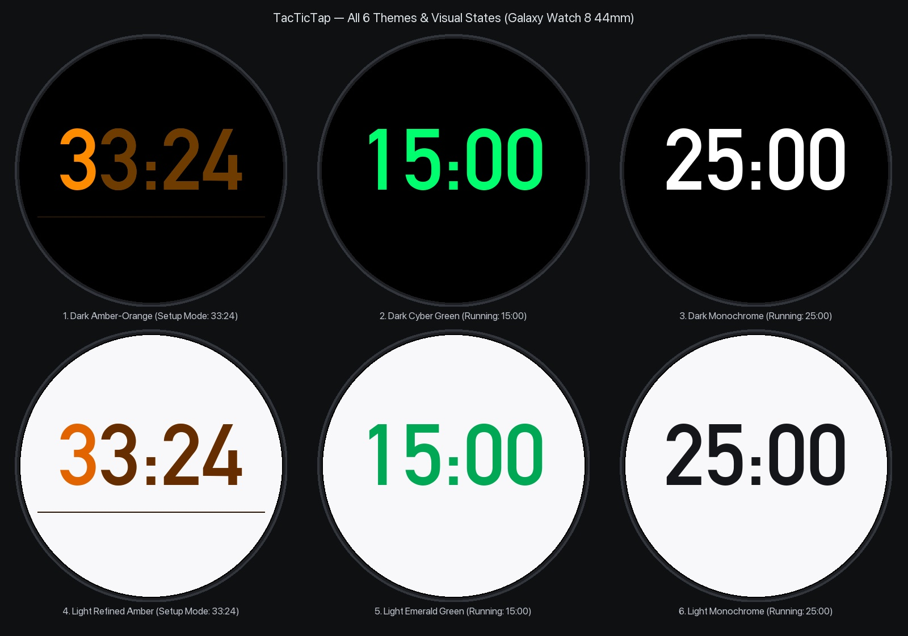

# Galaxy Watch / Wear OS ブラインド・タップタイマー＆アラーム (`galaxy-watch-timer`)
## 決定アプリ名: TacTicTap (タク・ティック・タップ)

---

## 1. 主要 Wear OS 端末一覧と画面解像度マトリクス（2024〜2026）

本アプリは、以下の主要 Android ウェアラブル端末の全解像度・画面サイズで、数字が見切れず、かつ余白を無駄にしない**「ダイナミック・レスポンシブ・スケーリング」**を採用します。

| メーカー・機種 | 画面サイズ / 形状 | 解像度 (px) | DPI / 密度 | 備考 |
| :--- | :--- | :--- | :--- | :--- |
| **Galaxy Watch 8 (44mm)** | 1.47〜1.5" 円形 | **480 × 480** | ~327 ppi | **メイン開発・実機ターゲット** |
| **Galaxy Watch 8 (40mm) / Watch 7** | 1.3" 円形 | **432 × 432** | ~330 ppi | 小型モデル |
| **Galaxy Watch Ultra / Ultra 2** | 1.5" 円形（角型ベゼル） | **480 × 480** | ~327 ppi | タフネスモデル |
| **Pixel Watch 3 / 4 / 5 (45mm)** | 1.4" 円形 (ドーム型) | **456 × 456 〜 480 × 480** | ~320 ppi | Google 純正 |
| **Pixel Watch 3 / 4 (41mm)** | 1.2" 円形 (ドーム型) | **450 × 450** | ~320 ppi | Google 純正小型 |
| **Xiaomi Watch 5 / S4** | 1.43〜1.54" 円形 | **466 × 466 〜 480 × 480** | ~326 ppi | 大画面狭ベゼル |
| **TicWatch Pro 5 / Atlas** | 1.43" 円形 | **466 × 466** | ~326 ppi | 2層ディスプレイ |

### 画面自動フィット（スケーリング）計算式
円形画面の幾何学制約（左右が中央より狭くなる）を考慮し、最も見切れやすい `y = 46%` の位置で、幅 `w = 直径 × 0.72` を専有する計算式を定義：
- 480×480px 端末: フォントサイズ **150pt**（幅 324px / 直径の67.5% を占有し、大迫力の視認性を実現）
- 432×432px 端末: フォントサイズ **135pt**
- 450×450px 端末: フォントサイズ **140pt**

---

## 2. 専属チーム体制（3大エージェント構成）

本プロジェクトを完璧に遂行するため、以下の3つの役割を確立し、連携して作業を進めます。

1. **🎨 視覚的デザイン担当（UI/UX Designer）:**
   - 画面余白の極小化とフォントサイズ極大化（110pt ➔ 150pt）の美学的チューニング。
   - 全6テーマ（ダーク3種・ライト3種）の色彩管理、点滅アニメーション、ヘアラインの視認性担保。
2. **💻 コーディング・アーキテクト担当（Core Engineer）:**
   - Compose for Wear OS によるネイティブ実装。
   - 大味タップ認識（上2/3: +1、下1/3: -1）、左スワイプ/ダブルピンチ、上スワイプ即スタート、下スワイプ戻る/リセットの状態機械。
   - バックグラウンド実行（`AlarmManager` / `WakeLock`）と Wear OS 標準ハプティクス（触覚フィードバック）の実装。
3. **🔍 統括・全画面テストプレイ審査担当（QA & Director）:**
   - 操作説明書を読まない初見の状態で「画面に映っている情報だけ」を手がかりに操作できるかを厳密検証。
   - 各端末プロファイル（480px, 450px, 432px, 466px）における見切れ・誤タップ・誤リセットの徹底検証と合否判定。

---

## 3. スワイプ＆ジェスチャー体系の完全版まとめ

### デフォルト操作
| 方向 | 操作内容 | 備考 |
| :--- | :--- | :--- |
| **左右スワイプ** | **桁移動** | 左スワイプで次の桁へ進む / 右スワイプで前の桁へ戻る |
| **上スワイプ（⬆）** | **確定（即スタート）** | 残り桁を00にして即座にカウントダウン開始 |
| **下スワイプ（⬇）** | **リセット** | 設定中は `00:00` へ全消去 / 一時停止中は設定画面へ戻す |
| **画面長押し** | **⚙️ 設定メニュー** | 左右・上下の操作入れ替え ＆ テーマ切り替え |
| **鳴動中の画面タップ / スワイプ** | **アラーム停止** | 画面を適当に叩くかスワイプするだけで音・バイブ即停止 |

### アラーム鳴動・音量・バイブレーションの本体準拠
- **サウンド:** ウォッチ標準のアラーム音（`USAGE_ALARM`）で鳴動し、本体の音量設定・マナーモードに100%自動連動します。
- **バイブレーション:** ウォッチ本体のバイブレーション強度設定に準拠し、リピート波形で確実に手首へ伝達します。

### アプリ内設定による操作の入れ替え機能
画面長押しで開く設定メニューから、好みに合わせてワンタップで反転・保存できます：
- **左右スワイプの入れ替え:**
  - `[通常]` 左スワイプで次桁 / 右スワイプで前桁
  - `[反転]` 右スワイプで次桁 / 左スワイプで前桁
- **上下スワイプの入れ替え:**
  - `[通常]` 上スワイプで確定 / 下スワイプでリセット
  - `[反転]` 下スワイプで確定 / 上スワイプでリセット

---

## 4. ダウンロード＆インストール方法

### APK ダウンロードURL（GitHub Releases 固定リンク）
GitHub Actions による自動ビルド完了後、以下のリンクから最新版 APK を直接ダウンロードできます：

- **ダウンロードURL:**  
  👉 **`https://github.com/ssdhouen361-ctrl/my-lab/releases/download/tactictap-latest/tactictap.apk`**
- **Releases ページ:**  
  👉 **`https://github.com/ssdhouen361-ctrl/my-lab/releases/tag/tactictap-latest`**

### Galaxy Watch へのインストール手順（スマホ経由）
1. スマホ（Galaxy S26 Ultra）で上記URLをタップして `tactictap.apk` をダウンロード。
2. スマホアプリ「**GeminiMan Wear OS Manager**」または「**Easy Fire Tools**」「**Bugjaeger**」等のウォッチ連携ツールを開く。
3. Watch と同じ Wi-Fi に接続し、ワイヤレスデバッグ経由で `tactictap.apk` を転送・インストール。
4. ウォッチのアプリ一覧に「**TacTicTap Timer**」と「**TacTicTap Alarm**」が追加されます！

*(余白を徹底的に削ぎ落とし、画面幅いっぱいに 150pt 特大フォントを配置)*
