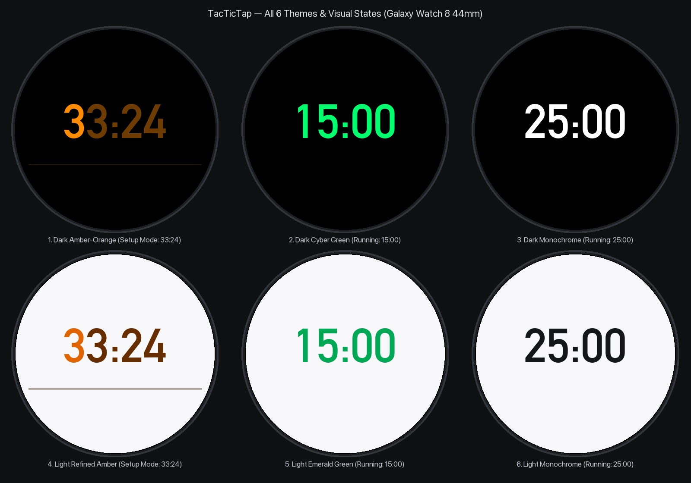

# Galaxy Watch / Wear OS ブラインド・タップタイマー＆アラーム (`galaxy-watch-timer`)
## 決定アプリ名: TacTicTap (タク・ティック・タップ)

---

## 1. デザイン美学・スマートなUI原則（野暮ったさの完全排除）

### 全6テーマ 決定版モックアップ（ピクセル完全再現）

- **上段（ダークテーマ）:**
  1. **Dark Amber-Orange:** 設定中（`33:24`）。先頭の「3」を100%強調、未入力部を45%の明るさに引き上げて視認性を大幅向上。
  2. **Dark Cyber Green:** 動作中（`15:00`）。
  3. **Dark Monochrome:** 動作中（`25:00`）。
- **下段（ライトテーマ）:**
  4. **Light Refined Amber:** 安っぽい蛍光色を廃し、高級感のある「リファインド・アンバー（エルメスオレンジ調）」へ洗練。
  5. **Light Emerald Green:** 動作中（`15:00`）。
  6. **Light Monochrome:** 動作中（`25:00`）。深みのあるチャコールブラック。

### 動作中（Running）のコロン点滅仕様
- **仕様:** タイマー・アラームが動作中（カウントダウン中）は、**「 : 」（コロン）が1秒周期で滑らかに点滅**（フェード点滅）。
- これにより、一目で「いまタイマーが順調に進んでいること」が直感的にわかります。
- **UIの大原則:** 画面上に「+1 Tap Area」「Swipe Left」のような野暮ったい説明テキストや矢印は**1文字も表示しない**。
- **純粋な数字のみの美しさ:** 画面には洗練された特大の数字 `00:00` のみを表示。
- **領域の境界線:** 上部2/3と下部1/3の境界は、テキストではなく、目立たない極細の半透明ヘアライン（またはわずかなトーンの差、あるいは完全非表示）で表現。身体（手触りとハプティクス振動）で覚えるプロ仕様のツールとして仕上げる。

### カラーテーマの統一感（ダークとライトで印象を揃える）
ダークテーマの持つ「サイバー感・鮮烈な発光感」の魅力を損なわないよう、ライトテーマの色調整を行う：
- ライトオレンジ：白っぽく薄まったり、くすんだ茶色に見えないよう、パキッとした「エレクトリック・オレンジ」の高彩度トーンを維持。
- ライトグリーン：ミリタリー調の暗い緑ではなく、鮮明な「ネオン・ライムグリーン/エメラルド」のソリッドなトーン。

---

## 2. 設定中の「やり直し・リセット」操作体系

設定の途中で「最初からやり直したい」「1つ前の桁に戻りたい」場合の操作フロー：

### A. 1つ前の桁に戻る（Undo）
- **操作:** **下スワイプ（⬇）**
- **動作:** 1つ前の桁に戻り、そこから叩き直せる。

### B. 最初から完全にやり直す（全クリア / リセット）
以下の2つのスマートな方法を採用：
1. **「一番最初の桁でさらに下スワイプ（⬇）」**:
   - 最初の桁（10分の位）にいる状態で下スワイプをすると、`00:00` に完全クリアされリセット振動。
2. **「2本指タップ」または「左右に振る（クイックキャンセル）」**:
   - どの桁の入力中であっても、画面を「2本指でポン」と叩くか、右スワイプ（Wear OSの戻るジェスチャー）でアプリを一度閉じて文字盤からワンタップで瞬時にクリア状態で開き直す。

---

## 3. スワイプ＆ジェスチャー体系の完全版まとめ

| 操作 | 画面入力中（Setup） | 動作中（Running） | 鳴動中（Ringing） |
| :--- | :--- | :--- | :--- |
| **画面上部 2/3 タップ** | `+1`（メイン加算） | 一時停止 / 再開 | **停止（Stop）** |
| **画面下部 1/3 タップ** | `-1`（減算・逆算） | 一時停止 / 再開 | **停止（Stop）** |
| **左スワイプ（⬅）/ ダブルピンチ** | **次の桁へ進む** | なし（誤操作防止） | **停止（Stop）** |
| **上スワイプ（⬆）** | **残り00で即スタート！** | なし（誤操作防止） | なし |
| **下スワイプ（⬇）** | **前の桁へ戻る / リセット** | （一時停止中のみ）リセット | なし |
| **右スワイプ（➔）** | アプリ終了（Wear OS標準） | アプリ終了（裏で継続） | 停止 |
